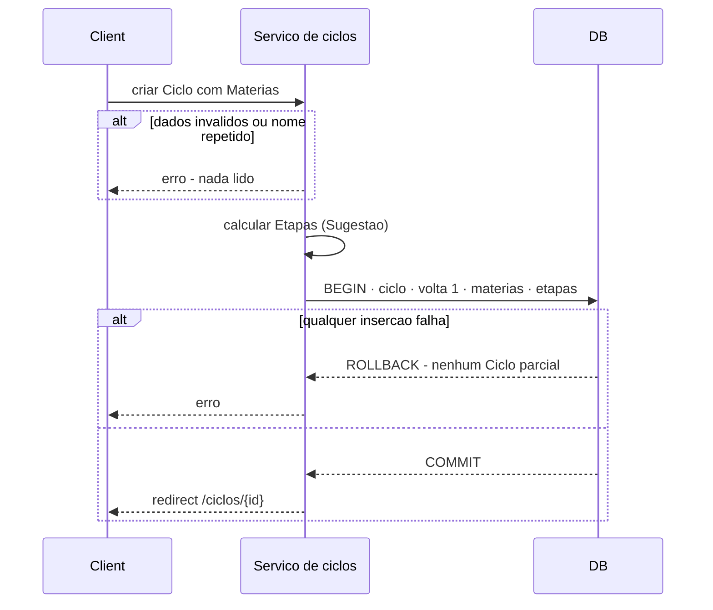

# Sugestão de ciclo

> Plan from this document. Each slice below carries its own shape - copy it, do not re-derive it.
> Status: confirmed by Guilherme Luan, 2026-11-22

## Situation

- Project: in steady use (self-hosted, com ciclos, voltas, registros, revisões e backup já entregues).
- Decision: committed by Guilherme Luan, 2026-11-22, no pedido desta funcionalidade; confirmou escala e valores na conversa.
- In flight: copia como precedente a criação atômica de Ciclo com Volta 1 e o aprendizado de "copiar matéria" (ADR-0001); a tela de Revisões (issue 12) é outra frente e fica de fora.
- At stake: barato de reverter - duas colunas anuláveis em `materia` e uma tela; só o formato do backup exige cuidado.

## Problem

Ausência. Hoje criar um Ciclo no Estudo Livre pede só o nome, e as Etapas entram uma a uma, cada uma com a carga horária digitada. Quem quer montar o ciclo a partir do peso de cada Matéria na prova e da sua própria dificuldade não consegue: o primeiro ciclo de Guilherme foi montado no app Aprovado e as cargas foram redigitadas aqui. O substituto é esse app externo; não há número medido (instância de um usuário, sem instrumentação) e o que sustenta o problema é o relato de uso.

## Success

- Worked if: o próximo Ciclo é criado inteiro no Estudo Livre, sem app externo e sem digitar a carga de cada Etapa.
- Going wrong: a maioria das Etapas sugeridas precisa ser editada à mão logo após criar - sinal de que fatores ou teto estão errados.
- Review: ao criar o próximo Ciclo real - Guilherme Luan.

## Boundary

In: Questões da prova e Dificuldade na Matéria; cálculo da sugestão; criação do Ciclo com Matérias e Etapas sugeridas na tela `/ciclos/novo`; backup levando os dois campos; entradas novas no `CONTEXT.md` (Dificuldade, Questões da prova, Sugestão de ciclo).

Out: coluna Peso do print - `CONTEXT.md` evita "peso" para carga horária e o pedido usa só questões e dificuldade. Total de horas da volta - a escala vem da duração da Etapa. Sugerir ou rebalancear Ciclo que já existe - hoje só se cria. Editar Dificuldade ou Questões da prova depois da criação - sem tela, vira issue se fizer falta. Importar matérias de outro ciclo ou do planejamento - "copiar matéria" já cobre o caso fora desta tela.

Unchanged: `etapa`, `volta`, progresso, Próxima etapa e horas extras; "Nova Etapa" e "copiar matéria" seguem como hoje.

## Shape

A Matéria passa a guardar Questões da prova e Dificuldade. A sugestão é um cálculo puro que transforma a lista de Matérias numa sequência ordenada de Etapas de duração fixa, e nada além das Etapas resultantes é persistido. A porta é o formato do backup, que ganha campos opcionais; mudá-los depois custa uma migração e uma regra de importação. A versão pesada guardaria o plano (pesos, fatores) para rebalancear o Ciclo a cada Volta; só vale se o Ciclo passar a ser revisto com frequência, e hoje nada no roadmap pede isso.

## Key decisions

1. **Dificuldade e Questões da prova pertencem à Matéria, são opcionais e as Matérias existentes ficam sem valor.** Dificuldade é `facil | media | dificil`; Questões da prova é inteiro maior que zero. Não há backfill: o cálculo só roda sobre Matérias digitadas na tela de criação, onde os dois campos são obrigatórios.
2. **O peso de uma Matéria é Questões da prova × fator, com fator 1 (Fácil), 1,5 (Média) e 2 (Difícil).** Matéria difícil recebe mais tempo.
3. **O número de Etapas da Matéria é peso ÷ menor peso da lista, arredondado (meio para cima), no mínimo 1 e no máximo 8.** Todas as Etapas têm a mesma duração, padrão 60 minutos e editável na tela. O teto impede que uma Matéria com muitas questões ocupe o Ciclo.
4. **A ordem é por rodadas, da Matéria de maior peso para a de menor; empate segue a ordem digitada.** Cada rodada leva uma Etapa de cada Matéria que ainda tem Etapas sobrando, então a mesma Matéria só aparece em sequência quando as outras acabaram.
5. **O Ciclo, a Volta 1, as Matérias e as Etapas nascem numa única operação.** O servidor recalcula a sugestão a partir das Matérias recebidas e nunca aceita Etapas prontas do cliente; se qualquer parte falha, nada fica criado.
6. **O backup continua na versão 1 e os campos novos são opcionais na exportação e na importação.** Arquivos antigos seguem importando, com valores nulos. A validação rígida da importação não pode recusar um arquivo por falta desses campos.
7. **A sugestão não deixa rastro: o Ciclo criado não sabe que foi sugerido.** Depois de criado, é um Ciclo comum, editável Etapa por Etapa.

## Work

| Slice | Delivers | Status |
|---|---|---|
| [Materia](#materia) | Questões da prova e Dificuldade guardadas e exportadas no backup | open — 1 default taken |
| [Sugestao](#sugestao) | O cálculo de Matérias para Etapas ordenadas | clear |
| [Novo ciclo](#novo-ciclo) | Criar o Ciclo já com Matérias e Etapas sugeridas em `/ciclos/novo` | design |

Order: Materia → Sugestao → Novo ciclo.

Already handled by existing code: nome do Ciclo vazio → recusa "Informe o nome do ciclo."; Ciclo criado fora do Arquivado → Volta 1 aberta como hoje.

Derivable from the repository, left to the plan: texto das mensagens de erro, limites de tamanho dos nomes, formato de horas na tela, componentes BoardUI da tabela - "all as Ciclo, Etapa e `docs/design-system.md` já fazem".

### Materia

**Delivers** a Matéria com os dois campos novos, que viajam no backup. **Status: open.** O cálculo e a tela dependem destes campos existirem.

| State | What should happen |
|---|---|
| Matéria antiga | Os dois campos ficam nulos; nada muda na interface |
| Matéria criada por Etapa manual | Nasce com os dois campos nulos |
| Exportar backup | Cada Matéria leva Dificuldade e Questões da prova, nulos quando vazios |
| Importar backup antigo, sem os campos | Importa normalmente, campos nulos |
| Importar backup com valor fora do enum ou questões não inteiras | Recusa como qualquer campo inválido do arquivo |

Table `materia`; os dois campos entram nela.

| Column | Type | Null | References | Note |
|---|---|---|---|---|
| `dificuldade` | enum `dificuldade_da_materia` (`facil`, `media`, `dificil`) | yes | | avaliação do Usuário sobre a Matéria |
| `questoes_da_prova` | integer | yes | | inteiro maior que zero quando presente |

Open, default taken:
1. "Copiar matéria" leva Dificuldade e não leva Questões da prova - a dificuldade é do Usuário, as questões são da prova do concurso do Ciclo de destino.

### Sugestao

**Delivers** o cálculo das Key decisions 2 a 4, sem tela nem persistência. **Status: clear.**

| State | What should happen |
|---|---|
| Uma só Matéria | Recebe 1 Etapa |
| Matérias de mesmo peso | Cada uma recebe o mesmo número de Etapas, na ordem digitada |
| Matéria cujo peso passa de 8 vezes o menor | Fica em 8 Etapas |
| Lista vazia | Nenhuma Etapa |

Exemplo para a conferência do plano: TI (50, Difícil), Estatística (7, Difícil), Língua Portuguesa (15, Média), Matemática (5, Difícil), Atualidades (5, Fácil), Conhecimentos Bancários (7, Difícil), Inglês (5, Fácil) dão 8, 3, 5, 2, 1, 3 e 1 Etapas, 23 no total.

Alternatives considered: fator só por dificuldade, sem Questões da prova - ganha se o Usuário não souber o número de questões; descartado porque o pedido usa os dois.

### Novo ciclo

**Delivers** a tela `/ciclos/novo` com Nome, duração da Etapa e a tabela de Matérias (nome, Questões da prova, Dificuldade com Média como padrão), o passo "Visualizar ciclo" e a criação. **Status: design.** A porta é a criação atômica (Key decision 5).

| State | What should happen | Caller sees |
|---|---|---|
| Tabela sem Matérias | Cria o Ciclo vazio, como hoje | `redirect` para `/ciclos/{id}` |
| Matéria sem Questões da prova ou com valor menor que 1 | Recusa antes de ler o banco | erro sob o campo |
| Nome de Matéria repetido na lista, sem diferenciar maiúsculas | Recusa; o Ciclo não é criado | erro de duplicidade |
| Duração da Etapa inválida | Recusa com a regra de carga horária que já existe | erro do campo |
| Visualizar ciclo | Mostra as Etapas na ordem sugerida e a carga total; os dados digitados voltam intactos ao editar | só leitura, sem gravar |
| Usuário abandona antes de criar | Nada é gravado | |
| Falha ao criar qualquer parte | Nada fica criado | erro genérico da tela |
| Criar com sucesso | Ciclo, Volta 1, Matérias e Etapas existem; segue para a página do Ciclo | `redirect` para `/ciclos/{id}` |

A criação reaproveita a action de `/ciclos/novo`, que passa a receber nome, duração da Etapa e a lista `{nome, questões da prova, dificuldade}`; a resposta de erro segue o formato de erro de hoje.

Alternatives considered: criar o Ciclo vazio e abrir a sugestão numa segunda tela - ganha se a tabela ficar pesada para o formulário atual.

Design: tela "Novo ciclo" com a tabela de Matérias e o passo de pré-visualização, nos estados vazio, erro de campo e prévia. O plano linka o frame do Figma "Estudo Livre — BoardUI"; se não existir, desenhar antes de implementar, seguindo `docs/design-system.md`.

## Migration

Duas colunas anuláveis em `materia`, sem backfill nem ordem de deploy especial: aplicar a migração e depois o código, que já tolera nulos. Backups exportados antes continuam importando (Key decision 6).

## Sources

- `CONTEXT.md` - vocabulário de Ciclo, Matéria, Etapa e Carga horária; "peso" a evitar.
- `docs/adr/0001-materias-isoladas-por-ciclo.md` e `docs/adr/0004-etapas-separadas-de-materias.md` - Matéria pertence a um Ciclo; Etapas são visitas à Matéria.
- Print do app Aprovado, fornecido por Guilherme Luan - referência da tabela de sugestão.
