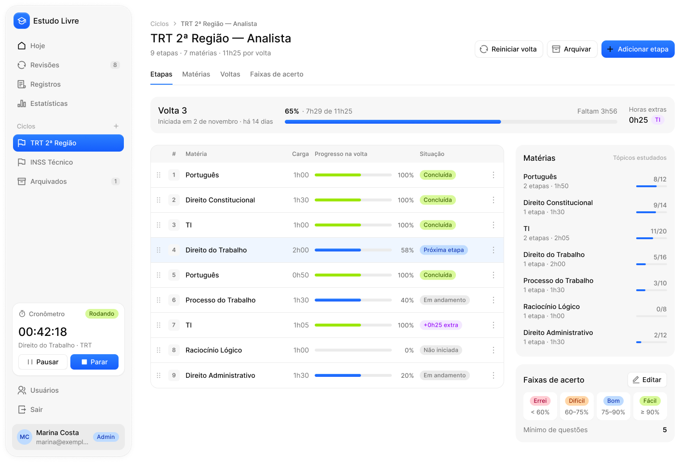

# Arquivar e reativar ciclo Specification

**Approved**: 2026-11-18 - user: "aprovado"

## Problem Statement

Um concurso termina ou pausa, mas o Ciclo dele continua ocupando a Hoje, a Sidebar e as sugestões de Próxima matéria. O Usuário precisa tirá-lo de cena sem perder Registros, Voltas nem Cartões, e trazê-lo de volta depois (issue #11).

## Goals

- [ ] Um Ciclo arquivado some da Hoje, das listas de Ciclos, da Próxima etapa e do seletor de Matéria, e todo o histórico fica intacto.
- [ ] O Usuário acha os Ciclos arquivados numa lista e reativa qualquer um com um clique.

## Out of Scope

| Feature | Reason |
| --- | --- |
| Suspender as Revisões de Ciclos arquivados | Não existe lista de Revisões ainda; o critério é da issue #12, que depende desta. Aqui o Cartão fica intacto |
| Excluir um Ciclo | Não pedido; arquivar é o caminho que preserva o histórico |
| Arquivar vários Ciclos de uma vez | Não pedido |
| Aba "Matérias" da captura | AD-001: entra pela issue dela |

---

## Assumptions & Open Questions

| Assumption / decision | Chosen default | Rationale | Confirmed? |
| --- | --- | --- | --- |
| Ordem da lista de arquivados | Do arquivado há menos tempo ao mais antigo | Quem arquivou agora costuma querer reativar primeiro | y - user delegated defaults ("Recommended") |
| Todos os Ciclos arquivados | A Hoje mostra o estado vazio atual ("Nenhum ciclo ainda") | O código já trata lista vazia; a Sidebar mostra "Arquivados" | y |
| Reativar pede confirmação | Não | Reativar desfaz o arquivamento e não perde nada | y |
| Arquivar um Ciclo já arquivado, ou reativar um ativo | Sem erro e sem mudança | Operação idempotente | y |
| Aviso após arquivar | A página volta à Hoje sem mensagem; o Ciclo some e o contador de "Arquivados" sobe | A mudança já é visível | y |

**Open questions:** none - all resolved or logged above.

---

## User Stories

### P1: Arquivar um Ciclo ⭐ MVP

**User Story**: Como Usuário, quero arquivar um Ciclo para que ele saia da tela inicial sem perder o histórico.

**Why P1**: É o núcleo da issue.

**Acceptance Criteria**:

1. WHEN o Usuário usa "Arquivar" no cabeçalho da tela de um Ciclo ativo THEN the system SHALL abrir um AlertDialog com o título "Arquivar ciclo?", o texto "O histórico de “<nome>” continua guardado e você pode reativar o ciclo quando quiser." e os botões "Cancelar" e "Arquivar", e o botão "Arquivar" do cabeçalho segue a composição de `.specs/features/arquivar-ciclo/captures/ciclo.png`
2. WHEN o Usuário usa "Cancelar" no AlertDialog THEN the system SHALL fechar o diálogo e manter o Ciclo ativo
3. WHEN o Usuário confirma com "Arquivar" THEN the system SHALL marcar o Ciclo como arquivado e levar o Usuário à Hoje
4. IF o Cronômetro ativo do Usuário é de uma Matéria do Ciclo THEN the system SHALL recusar o arquivamento com a mensagem "Pare ou descarte o cronômetro antes de arquivar." no diálogo e manter o Ciclo ativo
5. The system SHALL manter inalterados, ao arquivar e ao reativar, os Registros de estudo, as Voltas, as Etapas, as Matérias, os Tópicos, os Cartões de revisão e as Faixas de acerto do Ciclo
6. WHEN um Ciclo é arquivado THEN the system SHALL deixar de mostrá-lo na Hoje, na lista "Ciclos" da Sidebar, no menu da conta do celular, na Próxima etapa e na Matéria sugerida do registro e do Cronômetro
7. WHILE um Ciclo está arquivado the system SHALL omitir as Matérias dele do seletor de Matéria do modal de registro e do início do Cronômetro
8. WHEN o Usuário arquiva um Ciclo que já está arquivado THEN the system SHALL concluir sem erro e sem alterar nada
9. IF o Ciclo pertence a outro Usuário ou não existe THEN the system SHALL recusar arquivar e reativar como "não encontrado"

**Independent Test**: Arquivar um Ciclo com Registros e ver que ele sai da Hoje e da Sidebar, enquanto os Registros seguem no histórico.

---

### P1: Listar e reativar ⭐ MVP

**User Story**: Como Usuário, quero ver meus Ciclos arquivados e reativá-los.

**Why P1**: Sem isso arquivar seria definitivo.

**Acceptance Criteria**:

1. The system SHALL mostrar na Sidebar o item "Arquivados" entre os Ciclos e o Cronômetro, como no item "Arquivados" de `.specs/features/arquivar-ciclo/captures/ciclo.png`, ligado a `/ciclos/arquivados`
2. WHERE há ao menos um Ciclo arquivado the system SHALL mostrar no item "Arquivados" um Counter com a quantidade
3. WHILE não há Ciclo arquivado the system SHALL mostrar o item "Arquivados" sem Counter
4. The system SHALL oferecer "Arquivados" como item do menu da conta no celular (< 1024px)
5. WHEN o Usuário abre `/ciclos/arquivados` THEN the system SHALL listar um cartão por Ciclo arquivado, do arquivado mais recentemente ao mais antigo, com o nome, a Volta atual ("Volta N"), a quantidade de etapas e o botão "Reativar", e o nome leva à tela do Ciclo
6. WHILE não há Ciclo arquivado the system SHALL mostrar em `/ciclos/arquivados` o texto "Nenhum ciclo arquivado."
7. WHEN o Usuário usa "Reativar" THEN the system SHALL tornar o Ciclo ativo de novo e tirá-lo da lista de arquivados, e ele passa a aparecer na Hoje, na Sidebar, na Próxima etapa e no seletor de Matéria
8. WHEN o Usuário reativa um Ciclo que já está ativo THEN the system SHALL concluir sem erro e sem alterar nada

**Independent Test**: Arquivar, abrir "Arquivados", usar "Reativar" e ver o Ciclo de volta na Hoje com a mesma Volta e o mesmo progresso.

---

### P2: Ciclo arquivado em leitura

**User Story**: Como Usuário, quero consultar um Ciclo arquivado sem mexer nele por engano.

**Why P2**: Evita alterar um Ciclo fora de uso; o MVP já arquiva e reativa.

**Acceptance Criteria**:

1. WHILE um Ciclo está arquivado, WHEN o Usuário abre a tela dele THEN the system SHALL mostrar as mesmas abas e dados, com "Reativar" no lugar de "Arquivar" e sem "Adicionar etapa", "Reiniciar volta", "Renomear", o menu e a ordenação das Etapas, "Editar" das Faixas e as ações de Tópicos
2. IF uma escrita vem para um Ciclo arquivado (renomear, adicionar, editar, remover ou reordenar Etapa, reiniciar Volta, salvar Faixas, criar, importar, renomear, excluir ou marcar Tópico) THEN the system SHALL recusar com a mensagem "Ciclo arquivado. Reative para alterar." e não alterar nada
3. IF um registro novo, ou uma edição que troca a Matéria, ou o início do Cronômetro aponta para uma Matéria de Ciclo arquivado THEN the system SHALL recusar com a mensagem "Ciclo arquivado. Reative para alterar."
4. WHILE um Ciclo está arquivado the system SHALL permitir editar (sem trocar para Matéria dele) e excluir os Registros antigos dele pelo histórico, recalculando o Cartão como hoje

**Independent Test**: Abrir um Ciclo arquivado, não ver ações de alteração, e ver a recusa ao chamar uma escrita direto.

---

### P2: O histórico continua contando

**User Story**: Como Usuário, quero que o estudo feito num Ciclo arquivado continue nos meus números.

**Why P2**: Evita sumir horas; o comportamento já é o atual, só precisa ser garantido.

**Acceptance Criteria**:

1. WHILE um Ciclo está arquivado the system SHALL manter os Registros dele no histórico de Registros e nas Estatísticas, inclusive como opção do filtro de Ciclo de ambos
2. WHILE um Ciclo está arquivado the system SHALL continuar somando os Registros dele nos indicadores "Estudado hoje", "Questões hoje" e "Nesta semana" da Hoje

**Independent Test**: Arquivar um Ciclo com Registro de hoje e ver o mesmo "Estudado hoje".

---

## Edge Cases

- IF o Usuário arquiva o único Ciclo ativo THEN the system SHALL mostrar na Hoje "Nenhum ciclo ainda" e manter "Arquivados" com Counter 1
- IF o Cronômetro ativo é de uma Matéria de outro Ciclo THEN the system SHALL arquivar normalmente

---

## Requirement Traceability

| Requirement ID | Story | Phase | Status |
| --- | --- | --- | --- |
| ARQ-01 | P1: Arquivar (diálogo, cancelar, confirmar) | Specify | Pending |
| ARQ-02 | P1: Arquivar (Cronômetro ativo) | Specify | Pending |
| ARQ-03 | P1: Arquivar (nada do histórico muda) | Specify | Pending |
| ARQ-04 | P1: Arquivar (some das listas e sugestões) | Specify | Pending |
| ARQ-05 | P1: Arquivar (idempotência e dono) | Specify | Pending |
| ARQ-06 | P1: Listar (Sidebar, contador, celular) | Specify | Pending |
| ARQ-07 | P1: Listar (página dos arquivados) | Specify | Pending |
| ARQ-08 | P1: Reativar | Specify | Pending |
| ARQ-09 | P2: Ciclo arquivado em leitura | Specify | Pending |
| ARQ-10 | P2: Escritas recusadas | Specify | Pending |
| ARQ-11 | P2: Registros antigos editáveis | Specify | Pending |
| ARQ-12 | P2: O histórico continua contando | Specify | Pending |

**Coverage:** 12 total, 0 mapped to tasks, 12 unmapped ⚠️

---

## Differences from the source

| Source shows | Product shows | Confirmed |
| --- | --- | --- |
| Item "Revisões" com contador na Sidebar | Não aparece até a #12 | y - AD-001 |
| Aba "Matérias" na tela do Ciclo | Não aparece até a issue dela | y - AD-001 |
| Cartão do Cronômetro na Sidebar sem lixeira | O cartão mantém o botão "Descartar cronômetro" | y - AD-006 |
| Título do Ciclo sem controle ao lado | Link "Renomear" ao lado do título | y - AD-001 |
| Chip da Matéria (ex.: "TI") ao lado do valor de "Horas extras" no cartão da Volta | Só o valor, sem chip | y - AD-027 |

## Sources

- Issue #11 (https://github.com/GuilhermeLuan/estudo-livre/issues/11) - o que construir e critérios
- CONTEXT.md - "Ciclo arquivado": histórico mantido, revisões suspensas até reativar (as revisões ficam com a #12)
-  - binding - Sidebar com o item "Arquivados" e Counter, e o botão "Arquivar" no cabeçalho do Ciclo; a lista de arquivados, "Reativar" e o diálogo não estão desenhados
- AD-023 a AD-026 em `.specs/STATE.md`

---

## Success Criteria

- [ ] Arquivar e reativar um Ciclo devolve exatamente o mesmo estado de Registros, Voltas, Cartões e progresso.
- [ ] Nenhuma tela de Hoje, Sidebar ou seletor de Matéria mostra um Ciclo arquivado.
