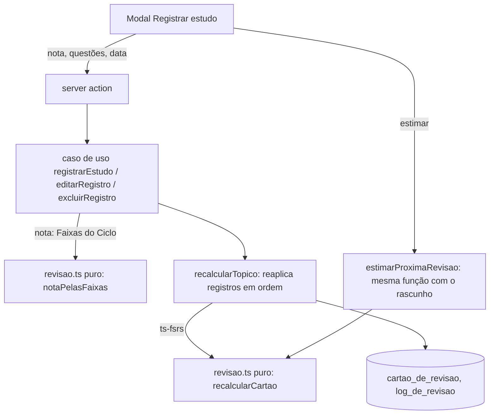

# Cartão de revisão Design

**Spec**: `.specs/features/cartao-de-revisao/spec.md`
**Status**: Approved with the spec (no new product decision; every choice below follows the spec and the ADRs)

## Architecture

## Where the rules run

Todas as regras (conversão de nota, sugestão, frase da faixa, validação das Faixas, recálculo e estimativa) ficam em `src/revisao.ts` (puro, sem banco) e nos casos de uso, que os testes alcançam. O modal só chama essas funções e mostra o resultado.

## Decisions

- **`ts-fsrs`** com `generatorParameters({ enable_fuzz: false, enable_short_term: false, request_retention: 0.9 })` (confirmado na documentação do `ts-fsrs`: os dois campos existem; `enable_fuzz` já é falso por padrão). Notas: Errei=Again(1), Difícil=Hard(2), Bom=Good(3), Fácil=Easy(4).
- **O Cartão é um valor derivado**: `recalcularTopico(tx, topicoId)` apaga Cartão e log do Tópico e os refaz dos Registros com `topicoId` e nota, em ordem (`dataHora`, `criadoEm`, `id`). Há Cartão se o Tópico tem ao menos um Registro; sem nota em nenhum, o Cartão é vazio (`proximaRevisao` nulo). Cada Registro com nota entra no log.
- **Dados**: `ciclo` ganha `faixa_errei_ate`, `faixa_dificil_ate`, `faixa_bom_ate` (60/75/90) e `minimo_de_questoes` (5); `registro_de_estudo` ganha `nota` (enum nulo); `cartao_de_revisao(topico_id pk, proxima_revisao timestamptz nulo, estado jsonb)` e `log_de_revisao(id, topico_id, registro_id, nota, revisado_em, antes jsonb, depois jsonb)`, os dois em cascata com o Tópico.
- **Nota no salvamento**: com Tópico e questões ≥ 1: se questões ≥ Mínimo, vale a nota enviada ou, sem ela, a das Faixas; abaixo do Mínimo, a nota enviada é obrigatória (`ValidacaoError("Escolha a nota da revisão.")`). Sem Tópico ou sem questões, a nota é descartada.
- **Estimativa**: `estimarProximaRevisao` roda a mesma conta do recálculo com o Registro do rascunho incluído (sem gravar) e devolve o dia de Brasília do vencimento, ou nulo.
- **Backfill (AD-021)**: a migração SQL grava `nota` nos Registros antigos (questões ≥ 5, Faixas padrão) e `scripts/cartoes.mjs` cria os Cartões; ele importa `src/revisao.ts` (Node 22 remove os tipos), que por isso não importa nada além de `ts-fsrs`.
- **Modal**: `MateriaParaRegistro` ganha `faixas` (e Mínimo) do Ciclo; a sugestão, a frase e o chip vêm das funções puras; só a data estimada é pedida ao servidor.

## Risks & Concerns

| Concern | Mitigation |
| --- | --- |
| `registrarEstudo` e `editarRegistro` já travam Ciclos; recalcular dentro da mesma transação alonga a trava | O Tópico tem dezenas de Registros: a conta é curta; roda dentro da transação já travada |
| Testes atuais registram Tópico com 1–4 questões sem nota, que agora é recusado (AD-020) | Os testes que dependem disso passam a enviar `nota` |
| Imagem de produção não copia `src/` | T4 copia só `src/revisao.ts` para a imagem |
