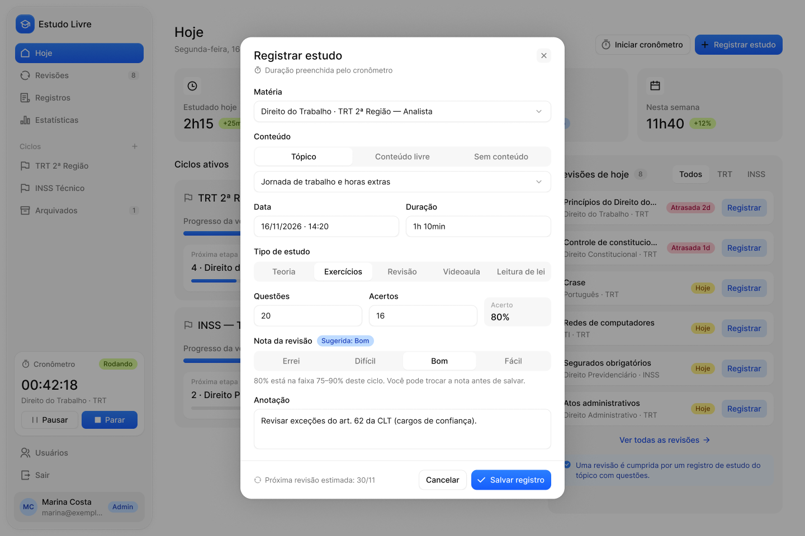
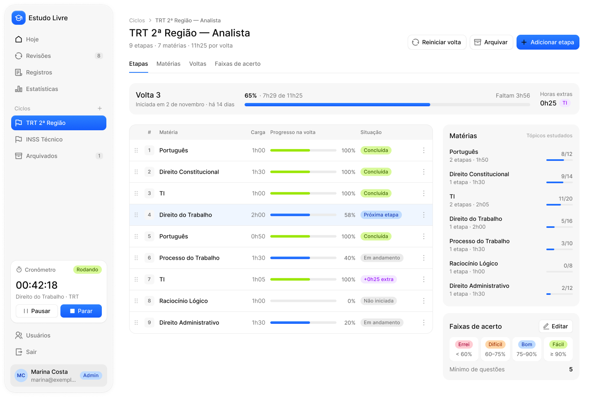

# Cartão de revisão (FSRS) Specification

**Approved**: 2026-11-18 - user: "aprovado"

## Problem Statement

O app registra estudo, mas não sabe quando um Tópico precisa ser revisto. A issue #10 dá a cada Tópico um Cartão de revisão FSRS (`ts-fsrs`), derivado dos Registros de estudo (ADR-0002): a porcentagem de acerto vira a Nota da revisão pelas Faixas de acerto do Ciclo, e o Tópico passa a ter uma data de próxima revisão. A tela de Revisões e o contador são da #12.

## Goals

- [ ] Todo Registro de Tópico com questões gera uma Nota da revisão (sugerida pelas Faixas, ou escolhida) e o Cartão do Tópico mostra a próxima revisão.
- [ ] O Cartão é sempre igual ao que se obtém reaplicando, em ordem cronológica, os Registros do Tópico: criar, editar, excluir e lançar retroativo mantêm essa igualdade.
- [ ] O Usuário vê e edita as Faixas de acerto e o Mínimo de questões de cada Ciclo.

## Out of Scope

| Feature | Reason |
| --- | --- |
| Tela de Revisões, contador "Revisões de hoje", filtro por Ciclo e ação "Registrar" a partir da Revisão | Issue #12 |
| Suspender Revisões de Ciclos arquivados, botão "Arquivar" | Issue #11 (AD-001) |
| Aba "Matérias" da tela do Ciclo e badge de Revisões na Sidebar | AD-001: só entra o que o app já tem ou as issues trazem |
| Otimizar os parâmetros do FSRS por usuário | ADR-0002: o log guardado permite fazer isso no futuro |
| Cartão para Registro sem Tópico (Conteúdo livre ou Sem conteúdo) | O Cartão é do Tópico (CONTEXT.md) |
| Reescrever as notas já gravadas quando as Faixas mudam | A Nota da revisão é um fato do Registro: vale a que foi dada ao salvar |

---

## Assumptions & Open Questions

| Assumption / decision | Chosen default | Rationale | Confirmed? |
| --- | --- | --- | --- |
| Primeiro Registro sem questões | Cria o Cartão sem data | AD-019 | y |
| Nota ausente abaixo do mínimo | Bloqueia o salvamento | AD-020 | y |
| Registros que já existem | Migração cria os Cartões deles | AD-021 | y |
| Onde o Tópico mostra a data | Lista de Tópicos da Matéria e rodapé do modal | AD-022 | y |
| Porcentagem usada na conversão | A que o modal já mostra: `percentualDeAcerto`, arredondada de 0 a 100; "Acertos" vazio com questões conta como 0 acertos | Uma só conta no modal e no servidor | n |
| Valor das Faixas | Três limites inteiros `a < b < c`, de 1 a 100: abaixo de `a` é Errei, de `a` até antes de `b` é Difícil, de `b` até antes de `c` é Bom, `c` ou mais é Fácil. Padrão 60, 75, 90 | A issue dá o padrão "<60 Errei, 60–75 Difícil, 75–90 Bom, ≥90 Fácil" | n |
| Mínimo de questões | Inteiro de 1 a 1000 (o máximo de questões de um Registro), padrão 5; "questões ≥ mínimo" sugere a nota | Issue #10 | n |
| Parâmetros do FSRS | Padrões do `ts-fsrs`, retenção 0,9, sem aleatoriedade (`enable_fuzz` falso) e sem passos de curto prazo (`enable_short_term` falso), para toda nota dar um intervalo em dias e o resultado ser repetível | Um app de estudo diário não agenda revisões em minutos; o recálculo do zero precisa ser determinístico | n |
| Ordem dos Registros no recálculo | Por data e hora do Registro, depois `criadoEm`, depois `id` | Mesmo desempate do histórico de Registros | n |
| Dia da próxima revisão | A data (dia de Brasília) da data de vencimento do Cartão; "vencida" é decidido pela #12 | O app trabalha em dias de Brasília (`hojeEmBrasilia`) | n |
| Registro de Tópico com questões = 0 ou vazias | Conta como "sem questões" | Issue #10: "Registros sem questões" | n |
| Matéria ou Tópico trocados na edição | O Cartão do Tópico de origem e o do destino são recalculados | AD-011 permite trocar tudo | n |
| Excluir um Tópico | O Cartão e o log dele somem; os Registros ficam (AD-009) | O Cartão é derivado dos Registros do Tópico, e o Tópico sumiu | n |
| Conteúdo da aba "Faixas de acerto" | O mesmo cartão "Faixas de acerto" da captura, na largura da aba | A captura mostra a aba e o cartão; só o cartão está desenhado | n |
| Edição das Faixas | Modal "Editar faixas de acerto" aberto pelo botão "Editar" do cartão, com os três limites e o Mínimo de questões | A captura desenha o botão "Editar" e nenhuma tela de edição | n |
| Mudar as Faixas | Só afeta Registros salvos depois | A nota fica gravada no Registro | n |
| Nota gravada na edição | Conta como escolhida pelo Usuário: mudar acertos ou questões em "Editar registro" não a troca; só o chip "Sugerida" e a frase acompanham as Faixas atuais | O Usuário a deu ou a aceitou ao salvar | n |

**Open questions:** none - all resolved or logged above.

---

## User Stories

### P1: Cartão derivado dos Registros ⭐ MVP

**User Story**: Como Usuário, quero que cada Tópico estudado tenha um Cartão de revisão calculado pelo meu desempenho em questões, para saber quando revê-lo.

**Why P1**: É o dado que a #12 lista e o núcleo do ADR-0002.

**Acceptance Criteria**:

1. WHEN o Usuário salva o primeiro Registro de um Tópico THEN the system SHALL criar o Cartão de revisão desse Tópico. <!-- REV-01 -->
2. WHEN o primeiro Registro de um Tópico não tem questões THEN the system SHALL criar o Cartão sem data de próxima revisão (AD-019). <!-- REV-01 -->
3. The system SHALL converter a porcentagem de acerto de um Registro de Tópico na Nota da revisão pelas Faixas do Ciclo da Matéria: abaixo do primeiro limite Errei, do primeiro ao segundo Difícil, do segundo ao terceiro Bom, do terceiro limite em diante Fácil; com as Faixas padrão 59% é Errei, 60% Difícil, 74% Difícil, 75% Bom, 89% Bom, 90% Fácil. <!-- REV-02 -->
4. WHEN o Registro de Tópico tem questões maiores ou iguais ao Mínimo de questões do Ciclo THEN the system SHALL sugerir a nota das Faixas e SHALL aceitar a nota que o Usuário escolher no lugar dela. <!-- REV-03 -->
5. WHEN o Registro de Tópico tem questões entre 1 e o Mínimo de questões menos 1 THEN the system SHALL exigir uma Nota da revisão escolhida pelo Usuário. <!-- REV-04 -->
6. IF o Registro de Tópico tem questões abaixo do Mínimo e o Usuário não escolheu a nota THEN the system SHALL recusar o salvamento com a mensagem "Escolha a nota da revisão." e SHALL manter Registro, Cartão e horas como estavam (AD-020). <!-- REV-04 -->
7. WHEN o Registro de Tópico não tem questões THEN the system SHALL gravá-lo sem nota e SHALL deixar o Cartão como está, exceto ao criá-lo. <!-- REV-05 -->
8. WHEN o Registro de Tópico tem uma Nota da revisão THEN the system SHALL aplicar essa nota ao Cartão na data do Registro e SHALL guardar no log de revisões a nota, a data e o estado do Cartão antes e depois. <!-- REV-06 -->
9. WHEN o Usuário cria, edita (inclusive trocando Matéria, Tópico, data, questões ou nota) ou exclui um Registro THEN the system SHALL recalcular do zero o Cartão de cada Tópico afetado, reaplicando em ordem cronológica os Registros que ainda existem, com resultado igual a ter lançado esses Registros um a um nessa ordem. <!-- REV-07 -->
10. WHEN o Usuário lança um Registro com data anterior à de Registros já existentes do Tópico THEN the system SHALL recalcular o Cartão como se o Registro tivesse sido lançado na ordem cronológica. <!-- REV-07 -->
11. WHEN o Usuário exclui o último Registro de um Tópico THEN the system SHALL remover o Cartão e o log de revisões desse Tópico. <!-- REV-07 -->
12. WHEN o Registro editado deixa de ter questões THEN the system SHALL apagar a nota dele e recalcular o Cartão sem ela. <!-- REV-07 -->
13. The system SHALL guardar o log de revisões do Tópico: um item por Registro com nota aplicada, com a nota, a data do Registro e o estado do Cartão antes e depois. <!-- REV-06 -->
14. WHEN o Tópico é excluído THEN the system SHALL excluir o Cartão e o log dele e SHALL manter os Registros (AD-009). <!-- REV-07 -->
15. WHEN a migração roda THEN the system SHALL criar os Cartões dos Tópicos que já têm Registros, dando aos Registros com questões ≥ 5 a nota das Faixas padrão e tratando os demais como sem nota (AD-021). <!-- REV-08 -->
16. The system SHALL calcular o Cartão só dos Registros que pertencem a Tópicos do Usuário que os salvou. <!-- REV-07 -->

**Independent Test**: Registrar 20 questões com 16 acertos num Tópico (Bom) e ver o Cartão com data; editar os acertos para 20 e ver a data mudar; excluir o Registro e ver o Cartão sumir.

---

### P1: Nota da revisão no modal de registro

**User Story**: Como Usuário, quero ver e trocar a nota sugerida e a próxima revisão estimada ao registrar estudo de um Tópico.

**Why P1**: A nota só entra no Cartão se o Usuário a vê e a controla.

**Acceptance Criteria**:

1. WHEN o Usuário escolhe um Tópico no modal "Registrar estudo" e informa 1 ou mais questões THEN the system SHALL mostrar a seção "Nota da revisão" com a composição do modal em `.specs/features/cartao-de-revisao/captures/registrar-estudo.png`: rótulo, chip "Sugerida: <nota>", o controle Errei / Difícil / Bom / Fácil e a frase da faixa. <!-- REV-09 -->
2. WHILE as questões são maiores ou iguais ao Mínimo, the system SHALL deixar a nota sugerida marcada e SHALL mostrar a frase "<N>% está na faixa <faixa> deste ciclo. Você pode trocar a nota antes de salvar." com N a porcentagem de acerto e <faixa> o texto da faixa como o cartão "Faixas de acerto" o escreve. <!-- REV-09 -->
3. WHILE as questões estão abaixo do Mínimo, the system SHALL deixar nenhuma nota marcada, SHALL omitir o chip "Sugerida" e SHALL mostrar a frase "Menos de <M> questões: escolha a nota da revisão." com M o Mínimo. <!-- REV-09 -->
4. WHEN o Usuário escolhe outra nota no controle THEN the system SHALL marcar a nota escolhida e SHALL gravá-la no Registro ao salvar. <!-- REV-09 -->
5. WHEN o Usuário muda questões, acertos, Matéria ou data com a nota ainda não trocada por ele THEN the system SHALL refazer a sugestão. <!-- REV-09 -->
6. WHEN o Tópico e os dados do rascunho dão ao Cartão uma data de próxima revisão THEN the system SHALL mostrar no rodapé do modal "Próxima revisão estimada: dd/mm", a mesma data que o Cartão terá depois de salvar o Registro. <!-- REV-10 -->
7. WHILE nenhuma data pode ser estimada (sem Tópico, ou o Cartão ficaria sem data) the system SHALL omitir o texto "Próxima revisão estimada". <!-- REV-10 -->
8. WHILE o conteúdo é Conteúdo livre ou Sem conteúdo the system SHALL omitir a seção "Nota da revisão". <!-- REV-09 -->
9. WHEN o Usuário abre "Editar registro" de um Registro com nota THEN the system SHALL mostrar a nota gravada marcada, e a sugestão pelas Faixas atuais do Ciclo quando houver questões suficientes. <!-- REV-09 -->
10. IF o servidor recusa o salvamento por falta de nota THEN the system SHALL mostrar o erro sob o controle da nota e SHALL manter os campos como estavam. <!-- REV-09 -->

**Independent Test**: Abrir "Registrar estudo", escolher um Tópico, 20 questões e 16 acertos e ver "Sugerida: Bom", a frase da faixa 75–90% e a data estimada; trocar para Fácil, salvar e ver a data no Tópico.

---

### P2: Faixas de acerto do Ciclo

**User Story**: Como Usuário, quero ver e editar as Faixas de acerto e o Mínimo de questões de cada Ciclo.

**Why P2**: Sem a tela, as Faixas ficam presas ao padrão, mas o P1 já funciona com ele.

**Acceptance Criteria**:

1. WHEN o Usuário abre a tela do Ciclo THEN the system SHALL mostrar a aba "Faixas de acerto" e, na aba "Etapas", o cartão "Faixas de acerto" abaixo do cartão "Matérias", como em `.specs/features/cartao-de-revisao/captures/ciclo.png`: Chips Errei, Difícil, Bom e Fácil com o texto da faixa ("< 60%", "60–75%", "75–90%", "≥ 90%"), a linha "Mínimo de questões" com o valor e o botão "Editar". <!-- REV-11 -->
2. The system SHALL dar a todo Ciclo, novo ou existente, as Faixas 60, 75 e 90 e o Mínimo de questões 5. <!-- REV-11 -->
3. WHEN o Usuário usa "Editar" THEN the system SHALL abrir o modal "Editar faixas de acerto" com os três limites e o Mínimo de questões preenchidos. <!-- REV-12 -->
4. WHEN o Usuário salva limites `a < b < c` entre 1 e 100 e um Mínimo entre 1 e 1000 THEN the system SHALL gravar no Ciclo e SHALL mostrar os novos valores no cartão. <!-- REV-12 -->
5. IF algum limite não é inteiro de 1 a 100, ou os limites não crescem estritamente, ou o Mínimo não é inteiro de 1 a 1000 THEN the system SHALL recusar com uma mensagem sob o campo e SHALL manter os valores gravados. <!-- REV-12 -->
6. WHEN as Faixas mudam THEN the system SHALL manter as notas já gravadas e SHALL usar as novas Faixas nos Registros seguintes. <!-- REV-12 -->
7. WHEN o Usuário abre a aba "Faixas de acerto" THEN the system SHALL mostrar o mesmo cartão com o botão "Editar". <!-- REV-11 -->
8. The system SHALL só mostrar e alterar as Faixas dos Ciclos do próprio Usuário. <!-- REV-12 -->

**Independent Test**: Abrir um Ciclo, "Editar", trocar o limite de Fácil para 95, salvar e ver "≥ 95%" no cartão; registrar 92% e ver a sugestão Bom.

---

### P2: Data da próxima revisão no Tópico

**User Story**: Como Usuário, quero ver na lista de Tópicos quando cada um deve ser revisto.

**Why P2**: A issue pede que cada Tópico mostre a data (AD-022).

**Acceptance Criteria**:

1. WHEN o Tópico tem Cartão com data THEN the system SHALL mostrar na lista de Tópicos da Matéria "Próxima revisão: dd/mm/aaaa" naquele Tópico. <!-- REV-13 -->
2. WHEN o Tópico não tem Cartão, ou o Cartão não tem data, THEN the system SHALL mostrar "Sem revisão agendada" naquele Tópico. <!-- REV-13 -->
3. WHEN um Registro muda o Cartão THEN the system SHALL mostrar a data nova na lista de Tópicos sem o Usuário recarregar a página. <!-- REV-13 -->

**Independent Test**: Registrar estudo de um Tópico com questões e ver a data na lista.

---

## Edge Cases

- IF o Registro de Tópico tem questões e "Acertos" vazio THEN the system SHALL contar 0 acertos (Errei, ou nota manual abaixo do Mínimo).
- WHEN dois Registros do mesmo Tópico têm a mesma data e hora THEN the system SHALL aplicá-los por `criadoEm` e depois por `id`.
- IF o Usuário escolhe uma nota que não é Errei, Difícil, Bom ou Fácil THEN the system SHALL recusar o Registro.
- WHEN o Usuário envia nota num Registro sem Tópico ou sem questões THEN the system SHALL ignorar a nota e SHALL gravar o Registro sem nota.
- IF o Tópico não pertence à Matéria escolhida THEN the system SHALL recusar como hoje, sem criar nem mudar Cartão.

---

## Requirement Traceability

| Requirement ID | Story | Phase | Status |
| --- | --- | --- | --- |
| REV-01 | P1: Cartão derivado | Specify | Pending |
| REV-02 | P1: Cartão derivado | Specify | Pending |
| REV-03 | P1: Cartão derivado | Specify | Pending |
| REV-04 | P1: Cartão derivado | Specify | Pending |
| REV-05 | P1: Cartão derivado | Specify | Pending |
| REV-06 | P1: Cartão derivado | Specify | Pending |
| REV-07 | P1: Cartão derivado | Specify | Pending |
| REV-08 | P1: Cartão derivado | Specify | Pending |
| REV-09 | P1: Nota no modal | Specify | Pending |
| REV-10 | P1: Nota no modal | Specify | Pending |
| REV-11 | P2: Faixas do Ciclo | Specify | Pending |
| REV-12 | P2: Faixas do Ciclo | Specify | Pending |
| REV-13 | P2: Data no Tópico | Specify | Pending |

**Coverage:** 13 total, 0 mapped to tasks, 13 unmapped ⚠️

---

## Differences from the source

| Source shows | Product shows | Confirmed |
| --- | --- | --- |
| Campo Data "dd/mm/aaaa · hh:mm" no modal | Data do navegador, sem hora | y - AD-007 |
| Campo único Duração "1h 10min" no modal | Horas e Minutos separados | y - AD-001 |
| Título "Registrar estudo" e botão "Salvar registro" na edição | "Editar registro" e "Salvar" | y - AD-013 |
| Aba "Matérias" e botão "Arquivar" na tela do Ciclo | Não aparecem até as issues delas | y - AD-001 |
| Cartão do Cronômetro na Sidebar sem lixeira | O cartão mantém o botão "Descartar cronômetro" | y - AD-006 |
| Título do Ciclo sem controle ao lado | Link "Renomear" ao lado do título | y - AD-001 |
| Ciclos e Revisões com contador na Sidebar, cartão "Revisões de hoje" ao fundo | Não aparecem até a #12 | y - AD-001 |

## Sources

- Issue #10 (https://github.com/GuilhermeLuan/estudo-livre/issues/10) - o que construir, critérios e testes pela fronteira
- ADR-0002 e CONTEXT.md - Cartão derivado, recálculo do zero, Faixas, Mínimo, vocabulário
-  - binding - modal "Registrar estudo" com "Nota da revisão", "Sugerida: Bom", frase da faixa e "Próxima revisão estimada: 30/11"
-  - binding - tela do Ciclo com a aba e o cartão "Faixas de acerto" (Chips, "Mínimo de questões", "Editar")

---

## Success Criteria

- [ ] Para qualquer sequência de criar, editar, excluir e lançar retroativo, o Cartão guardado é igual ao reaplicado do zero.
- [ ] A data mostrada em "Próxima revisão estimada" é a que o Tópico mostra depois de salvar.
- [ ] Os dois frames do Figma conferidos nos temas Claro suave e Escuro, com Sidebar a partir de 1024px.
