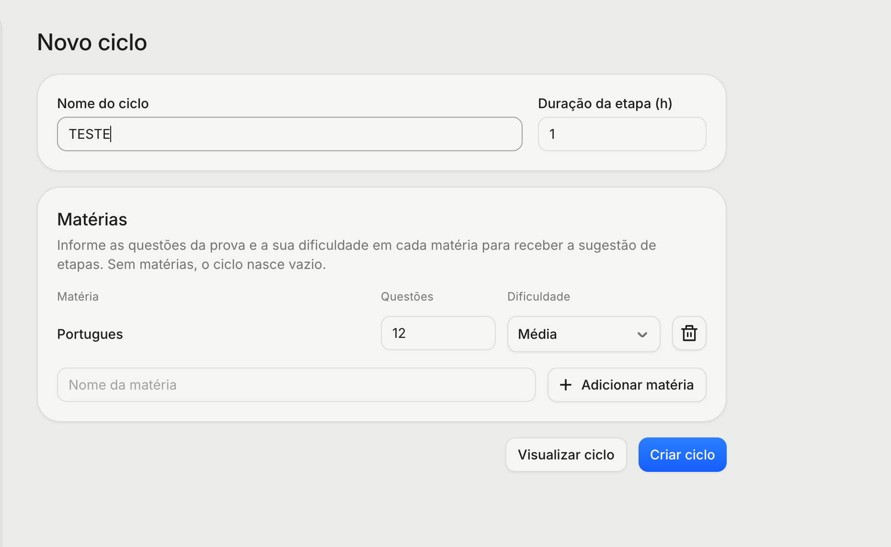

# Editar ciclo Specification

**Approved**: 2026-11-25 - user: "Aprovado"

## Problem Statement

A Sugestão de ciclo só existe na criação: depois de criado, o Usuário não consegue voltar à tela de Matérias com Questões da prova e Dificuldade para mudar um valor e ver as Etapas recalculadas. Hoje a única saída é editar Etapa por Etapa à mão ou criar outro Ciclo e perder Registros, Tópicos e Voltas.

## Goals

- [ ] O Usuário reabre a tela da captura já preenchida com o Ciclo, muda Questões da prova, Dificuldade, Matérias ou duração e gera as novas Etapas no mesmo Ciclo
- [ ] Nada do histórico se perde: Registros, Tópicos, Cartões de revisão e Voltas continuam

## Out of Scope

| Feature | Reason |
| --- | --- |
| Criar um Ciclo novo a partir de um existente | AD-039: gerar refaz as Etapas do mesmo Ciclo |
| Renomear Matéria pela tela de edição | A tela só acrescenta e remove linhas; renomear segue em "Editar etapa" |
| Manter a ordem ou cargas manuais ao gerar | Gerar substitui todas as Etapas (com confirmação); ajuste fino continua nas Etapas depois |
| Reiniciar a Volta ao gerar | AD-040: a Volta aberta continua |
| Editar Ciclo arquivado | AD-024: arquivado é só leitura |
| Apagar Registros ou Tópicos de Matéria tirada da lista | AD-039 segue AD-008 |

---

## Assumptions & Open Questions

| Assumption / decision | Chosen default | Rationale | Confirmed? |
| --- | --- | --- | --- |
| Resultado de "Gerar ciclo" | Refaz as Etapas do mesmo Ciclo | AD-039 | y |
| Matéria tirada da lista | Perde as Etapas; fica se tem Registro ou Tópico, senão é apagada | AD-039, AD-008 | y |
| Volta aberta | Continua; progresso recalculado; fecha com aviso se tudo ficar 100% | AD-040, AD-018 | y |
| Duração da etapa | Gravada no Ciclo; sem valor, a carga mais comum das Etapas (empate: a menor), ou 1h | AD-041 | y |
| Entrada e textos | Botão "Editar ciclo" no topo do Ciclo → `/ciclos/{id}/editar`; título "Editar ciclo"; botão "Gerar ciclo" com AlertDialog | AD-042 | y |
| Quais Matérias preenchem a lista | As que têm ao menos uma Etapa, na ordem da primeira Etapa de cada uma; Matérias sem Etapa (guardadas por AD-008) não aparecem | A lista descreve o ciclo de Etapas em vigor | n |
| Matéria sem Questões da prova ou Dificuldade gravadas (criada à mão) | Linha com "Questões" vazio e Dificuldade "Média"; Visualizar/Gerar recusam até o Usuário preencher | Mesma validação da criação | n |
| Linha acrescentada com nome de Matéria já guardada sem Etapa | Reaproveita essa Matéria (sem diferenciar maiúsculas) com seus Registros e Tópicos | Mesma regra de "Adicionar etapa" (`materiaDoCiclo`) | y - default of the code |
| "Gerar ciclo" com a lista vazia | Recusado com "Adicione ao menos uma matéria para gerar as etapas."; "Gerar ciclo" e "Visualizar ciclo" ficam desabilitados | AD-043 | y |
| Texto da confirmação | Título "Gerar ciclo?", texto "As etapas atuais serão substituídas pelas da sugestão. Registros, tópicos e voltas continuam.", botões "Cancelar" e "Gerar ciclo" | AD-042 pede confirmação; o texto diz o que muda e o que fica | n |
| Descrição do cartão Matérias na edição | Sem a frase "Sem matérias, o ciclo nasce vazio." | AD-043 | y |
| Matéria apagada com Cronômetro ativo | Segue `descartarMateriaSemUso` de hoje (o Cronômetro dela vai junto, como em "Remover etapa") | Comportamento atual do código | y - default of the code |
| Ciclo arquivado ou de outro Usuário em `/ciclos/{id}/editar` | Arquivado: recusa com a mensagem de escrita em arquivado (AD-024) e a página não mostra o formulário; outro Usuário/inexistente: 404 como na página do Ciclo | Regras existentes de `travarCiclo` e `exigirCiclo` | y - default of the code |
| Sessão e envio | Sem sessão → `/entrar`; "Gerar ciclo" desabilitado enquanto envia | Comportamento de `SugestaoDeCiclo` e `exigirUsuario` | y - default of the code |
| Concorrência | Gerar trava o Ciclo (`travarCiclo`) e grava tudo numa transação | Mesma garantia das outras escritas de Etapa | y - default of the code |

**Open questions:** none - all resolved or logged above (rows marked `n` are defaults for the user to correct at approval).

---

## User Stories

### P1: Voltar à sugestão e gerar novas Etapas ⭐ MVP

**User Story**: As a Usuário, I want reabrir a tela de Matérias do meu Ciclo já preenchida so that eu mude Questões da prova e Dificuldade e gere as Etapas de novo sem perder meu histórico.

**Why P1**: É o pedido inteiro.

**Acceptance Criteria**:

1. EDIT-01: WHILE o Ciclo não está arquivado, the system SHALL mostrar o botão "Editar ciclo" no topo de `/ciclos/{id}`, que leva a `/ciclos/{id}/editar`; no Ciclo arquivado o botão não aparece
2. EDIT-02: WHEN o Usuário usa "Editar ciclo" THEN the system SHALL mostrar a tela em `.specs/features/editar-ciclo/captures/editar-ciclo.png`, com título "Editar ciclo" e botão "Gerar ciclo" no lugar de "Novo ciclo" e "Criar ciclo"
3. EDIT-03: WHEN a tela de edição abre THEN the system SHALL preencher "Nome do ciclo" com o nome do Ciclo e a tabela com uma linha por Matéria que tem Etapa, na ordem da primeira Etapa de cada uma, com as Questões da prova e a Dificuldade gravadas
   - Ciclo criado pela sugestão com Português (12, Média) → linha "Português", "12", "Média"
4. EDIT-04: IF a Matéria não tem Questões da prova ou Dificuldade gravadas THEN the system SHALL mostrar a linha com "Questões" vazio e Dificuldade "Média"
5. EDIT-05: WHEN a tela de edição abre THEN the system SHALL preencher "Duração da etapa (h)" com a duração gravada no Ciclo; sem valor gravado, com a carga mais comum das Etapas (empate: a menor); sem Etapas, com "1"
   - gravada 90 min → "1,5"; sem gravada e Etapas de 60, 60, 120 → "1"; 60 e 120 → "1"
6. EDIT-06: The system SHALL aplicar na edição as mesmas regras da criação para acrescentar, remover, repetir e limitar linhas, validar Questões e duração, e calcular a visualização (criação, critérios 2 a 5, 7 a 14)
7. EDIT-07: WHEN o Usuário usa "Gerar ciclo" com linhas válidas THEN the system SHALL abrir um AlertDialog com título "Gerar ciclo?", o texto "As etapas atuais serão substituídas pelas da sugestão. Registros, tópicos e voltas continuam." e os botões "Cancelar" e "Gerar ciclo"
8. EDIT-08: WHEN o Usuário usa "Cancelar" no AlertDialog THEN the system SHALL fechar o diálogo, manter o formulário como estava e não gravar nada
9. EDIT-09: WHEN o Usuário confirma "Gerar ciclo" THEN the system SHALL, numa só transação, gravar o nome e a duração no Ciclo, substituir todas as Etapas do Ciclo pelas Etapas sugeridas (duração informada, posições 0 a N-1 na ordem sugerida), gravar Questões da prova e Dificuldade em cada Matéria da lista e ir para `/ciclos/{id}`
   - as Etapas gravadas são as mesmas que "Visualizar ciclo" mostrou para a mesma lista
10. EDIT-10: WHEN uma linha tem o nome de uma Matéria que já existe no Ciclo, sem diferenciar maiúsculas THEN the system SHALL reaproveitar essa Matéria, com o mesmo id, seus Registros, Tópicos e Cartões de revisão
11. EDIT-11: WHEN uma linha tem um nome que não existe no Ciclo THEN the system SHALL criar a Matéria com essas Questões da prova e Dificuldade
12. EDIT-12: WHEN uma Matéria com Etapas não está mais na lista THEN the system SHALL remover as Etapas dela; IF ela tem Registro de estudo ou Tópico THEN the system SHALL mantê-la, senão SHALL apagá-la (AD-008)
13. EDIT-13: WHEN as Etapas são geradas THEN the system SHALL manter a Volta aberta com o mesmo número e início, e o progresso da página do Ciclo SHALL ser recalculado com as horas já registradas nela preenchendo as novas Etapas de cada Matéria
    - Volta 2 com 3h de Português; geradas 2 Etapas de 1h de Português → as duas em 100% e 1h extra
14. EDIT-14: IF as novas Etapas ficam todas em 100% THEN the system SHALL fechar a Volta e mostrar em `/ciclos/{id}` o aviso "Volta N concluída. A Volta N+1 começou." (AD-018)
15. EDIT-15: IF "Gerar ciclo" é usado com a tabela sem linhas THEN the system SHALL recusar com "Adicione ao menos uma matéria para gerar as etapas." e não gravar nada; "Gerar ciclo" e "Visualizar ciclo" ficam desabilitados sem linhas
16. EDIT-16: IF qualquer gravação da geração falha THEN the system SHALL manter o Ciclo, as Etapas e as Matérias como estavam
    - nome de Matéria repetido chegando ao caso de uso → recusado com "A matéria “<nome>” já está na lista." e as Etapas do Ciclo não mudam
17. EDIT-17: IF o Ciclo está arquivado THEN the system SHALL recusar a geração com a mensagem de escrita em Ciclo arquivado e não gravar nada; `/ciclos/{id}/editar` de Ciclo arquivado não mostra o formulário
18. EDIT-18: IF o Ciclo não existe ou é de outro Usuário THEN the system SHALL responder com a página de não encontrado em `/ciclos/{id}/editar` e recusar a geração
19. EDIT-19: The system SHALL ignorar Etapas enviadas pelo cliente: o caso de uso recebe nome, duração e Matérias e deriva as Etapas
20. EDIT-20: IF o nome do Ciclo está vazio THEN the system SHALL recusar com "Informe o nome do ciclo." e não gravar nada
21. EDIT-21: WHILE a geração está sendo enviada the system SHALL manter "Gerar ciclo" desabilitado
22. EDIT-22: The system SHALL omitir na edição a frase "Sem matérias, o ciclo nasce vazio." da descrição do cartão Matérias, mantendo o resto do texto
23. EDIT-23: WHEN o Usuário cria um Ciclo em `/ciclos/novo` THEN the system SHALL gravar a duração da Etapa informada no Ciclo
24. EDIT-24: WHEN o Usuário usa a tela de edição a 1860px e a 390px de largura THEN the system SHALL mostrar a tabela utilizável, sem rolagem horizontal da página, e "Visualizar ciclo" e "Gerar ciclo" alcançáveis

**Independent Test**: Criar um Ciclo pela sugestão com Português (12, Média), registrar estudo, usar "Editar ciclo", mudar para Difícil, acrescentar Matemática e gerar: as Etapas mudam, os Registros e a Volta continuam.

---

### P2: Backup preserva a duração da etapa

**User Story**: As a Usuário, I want que a duração da Etapa gravada no Ciclo sobreviva ao backup so that a edição abre com o mesmo valor depois de importar.

**Why P2**: Campo novo no Ciclo; o backup já leva os campos da Matéria.

**Acceptance Criteria**:

1. EDIT-25: WHEN o Usuário exporta o backup THEN the system SHALL incluir em cada Ciclo `duracaoEtapaMinutos` (inteiro ou `null`)
2. EDIT-26: WHEN o Usuário importa um backup versão 1 com ou sem `duracaoEtapaMinutos` THEN the system SHALL recriar o Ciclo com o valor, ou nulo quando ausente
3. EDIT-27: IF o arquivo traz `duracaoEtapaMinutos` que não seja inteiro de 1 a 600.000 nem `null` THEN the system SHALL recusar o arquivo com a recusa de arquivo inválido que a importação já tem

**Independent Test**: Exportar um Ciclo com duração gravada, importar e abrir a edição: a duração é a mesma.

---

## Edge Cases

- IF a Matéria da lista tem Questões vazia (criada à mão) THEN system SHALL recusar Visualizar/Gerar com "Informe as questões da prova (inteiro de 1 a 10.000)." sob o campo (EDIT-04, EDIT-06)
- WHEN a lista tem 50 linhas THEN system SHALL recusar a 51ª com "A sugestão aceita até 50 matérias." (EDIT-06)
- IF o Ciclo tem mais de 50 Matérias com Etapa THEN system SHALL abrir a edição com todas, e só recusar acrescentar novas (EDIT-03)

---

## Requirement Traceability

| Requirement ID | Story | Phase | Status |
| --- | --- | --- | --- |
| EDIT-01 | P1: Voltar à sugestão e gerar novas Etapas | Tasks | Pending |
| EDIT-02 | P1: Voltar à sugestão e gerar novas Etapas | Tasks | Pending |
| EDIT-03 | P1: Voltar à sugestão e gerar novas Etapas | Tasks | Pending |
| EDIT-04 | P1: Voltar à sugestão e gerar novas Etapas | Tasks | Pending |
| EDIT-05 | P1: Voltar à sugestão e gerar novas Etapas | Tasks | Pending |
| EDIT-06 | P1: Voltar à sugestão e gerar novas Etapas | Tasks | Pending |
| EDIT-07 | P1: Voltar à sugestão e gerar novas Etapas | Tasks | Pending |
| EDIT-08 | P1: Voltar à sugestão e gerar novas Etapas | Tasks | Pending |
| EDIT-09 | P1: Voltar à sugestão e gerar novas Etapas | Tasks | Pending |
| EDIT-10 | P1: Voltar à sugestão e gerar novas Etapas | Tasks | Pending |
| EDIT-11 | P1: Voltar à sugestão e gerar novas Etapas | Tasks | Pending |
| EDIT-12 | P1: Voltar à sugestão e gerar novas Etapas | Tasks | Pending |
| EDIT-13 | P1: Voltar à sugestão e gerar novas Etapas | Tasks | Pending |
| EDIT-14 | P1: Voltar à sugestão e gerar novas Etapas | Tasks | Pending |
| EDIT-15 | P1: Voltar à sugestão e gerar novas Etapas | Tasks | Pending |
| EDIT-16 | P1: Voltar à sugestão e gerar novas Etapas | Tasks | Pending |
| EDIT-17 | P1: Voltar à sugestão e gerar novas Etapas | Tasks | Pending |
| EDIT-18 | P1: Voltar à sugestão e gerar novas Etapas | Tasks | Pending |
| EDIT-19 | P1: Voltar à sugestão e gerar novas Etapas | Tasks | Pending |
| EDIT-20 | P1: Voltar à sugestão e gerar novas Etapas | Tasks | Pending |
| EDIT-21 | P1: Voltar à sugestão e gerar novas Etapas | Tasks | Pending |
| EDIT-22 | P1: Voltar à sugestão e gerar novas Etapas | Tasks | Pending |
| EDIT-23 | P1: Voltar à sugestão e gerar novas Etapas | Tasks | Pending |
| EDIT-24 | P1: Voltar à sugestão e gerar novas Etapas | Tasks | Pending |
| EDIT-25 | P2: Backup preserva a duração da etapa | Tasks | Pending |
| EDIT-26 | P2: Backup preserva a duração da etapa | Tasks | Pending |
| EDIT-27 | P2: Backup preserva a duração da etapa | Tasks | Pending |

**Coverage:** 27 total, 0 mapped to tasks, 27 unmapped ⚠️

---

## Differences from the source

| Source shows | Product shows | Confirmed |
| --- | --- | --- |
| Título "Novo ciclo" | "Editar ciclo" | y - AD-042 |
| Botão "Criar ciclo" | "Gerar ciclo", com AlertDialog | y - AD-042 |
| Descrição termina em "Sem matérias, o ciclo nasce vazio." | Frase omitida na edição | y - AD-043 |

## Sources

-  - binding - a tela de Novo ciclo com Nome, Duração da etapa, cartão Matérias (Matéria, Questões, Dificuldade, lixeira, Adicionar matéria) e os botões Visualizar ciclo / Criar ciclo, à qual a edição volta
- `.specs/features/sugestao-de-ciclo/plan.md` - regras da sugestão (critérios S1-2 a S1-14) reaproveitadas por EDIT-06
- `.specs/STATE.md` AD-008, AD-018, AD-024, AD-037, AD-038, AD-039 a AD-042

---

## Success Criteria

- [ ] Mudar a Dificuldade de uma Matéria e gerar leva menos de 30 segundos a partir da página do Ciclo
- [ ] Zero Registros, Tópicos ou Voltas perdidos ao gerar
