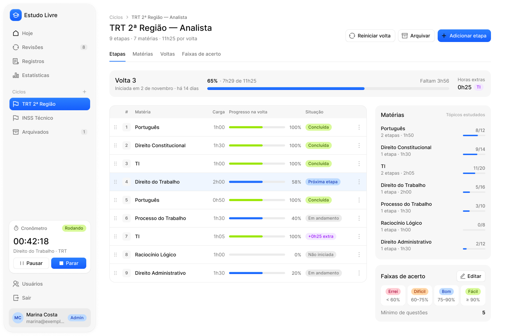

# Gestão de voltas Specification

**Approved**: 2026-11-17 - user: "Ok"

## Problem Statement

O Usuário só vê a Volta atual de cada Ciclo e não pode recomeçá-la quando quiser. Quando muda a carga horária ou remove uma Etapa, o progresso se recalcula, mas a Volta não fecha mesmo que todas as Etapas passem a estar em 100%. A issue #6 entrega o histórico de Voltas, o botão "Reiniciar volta" e o fechamento por mudança de carga.

## Goals

- [ ] A tela do Ciclo tem a aba "Voltas" com uma linha por Volta: número, início, fim e duração.
- [ ] "Reiniciar volta" fecha a Volta aberta e abre a seguinte, depois de uma confirmação.
- [ ] Adicionar, editar ou remover uma Etapa recalcula o progresso da Volta aberta e a fecha quando todas as Etapas chegam a 100%.

## Out of Scope

| Feature | Reason |
| --- | --- |
| Horas ou percentual estudado de cada Volta fechada no histórico | A issue pede número, início, fim e duração |
| Reabrir ou desfazer um "Reiniciar volta" | AD-010: Volta fechada nunca reabre |
| Abas "Matérias" e "Faixas de acerto" e botão "Arquivar" da captura | AD-001: entram pelas issues delas |
| Excluir ou editar uma Volta do histórico | Fora da issue |
| Reordenar Etapas fechar a Volta | Reordenar não muda a carga nem o estudo de nenhuma Matéria |

---

## Assumptions & Open Questions

| Assumption / decision | Chosen default | Rationale | Confirmed? |
| --- | --- | --- | --- |
| Datas do histórico | `dd/mm/aaaa` no fuso de Brasília (`FUSO`) | Mesmo fuso que `descricaoDaVolta` e `hojeEmBrasilia` | n |
| Duração | Dias de calendário entre a data de início e a de fim (a de hoje, na Volta aberta), no fuso de Brasília; 0 vira "Mesmo dia", 1 vira "1 dia", N vira "N dias" | Mesma conta de `descricaoDaVolta` | n |
| Conteúdo da aba "Etapas" | O cartão da Volta, a tabela de Etapas e o cartão "Matérias" ficam dentro da aba "Etapas"; a aba "Voltas" mostra só a tabela | A captura mostra a aba "Etapas" selecionada com esse conteúdo | n |
| Troca de aba | Estado da própria tela, sem mudar a URL | Menor mudança; a issue não pede link direto | n |
| Reordenar Etapas | Não avalia o fechamento da Volta | Reordenar não muda o estudo de nenhuma Matéria | n |
| Adicionar, editar e remover Etapa | As três avaliam o fechamento da Volta | Uma Matéria com horas extras pode completar uma Etapa nova na hora | n |
| Largura da tela | Abaixo de 1024px a tabela rola na horizontal dentro do próprio cartão, sem rolar a página | Mesmo comportamento da tabela de Etapas; layout é decisão do construtor, preso ao design system | n |
| Reiniciar duas vezes por duplo clique | O pedido carrega o número da Volta que o Usuário viu; se a Volta aberta já é outra, o segundo pedido falha com "Esta volta já foi reiniciada. Atualize a página." | Evita fechar a Volta nova por engano | n |

**Open questions:** none - all resolved or logged above.

---

## User Stories

### P1: Histórico de Voltas ⭐ MVP

**User Story**: As a Usuário, I want ver as Voltas de cada Ciclo com início, fim e duração, so that eu acompanhe meu ritmo.

**Why P1**: É o primeiro critério da issue e dá sentido aos outros dois.

**Acceptance Criteria**:

1. WHEN o Usuário abre `/ciclos/[id]` THEN the system SHALL mostrar a tela de `.specs/features/gestao-de-voltas/captures/ciclo.png` com as abas "Etapas" (selecionada) e "Voltas" e o botão "Reiniciar volta" ao lado de "Adicionar etapa"  <!-- VOLTA-01 -->
2. WHEN o Usuário escolhe a aba "Voltas" THEN the system SHALL mostrar uma tabela com as colunas "Volta", "Início", "Fim" e "Duração", uma linha por Volta do Ciclo, da maior para a menor numeração  <!-- VOLTA-02 -->
3. The system SHALL mostrar, numa Volta fechada, o início e o fim como `dd/mm/aaaa` e a duração em dias de calendário, com "Mesmo dia" quando as duas datas são iguais e "1 dia" quando a diferença é 1  <!-- VOLTA-03 -->
4. The system SHALL mostrar a Volta aberta como a primeira linha, com Fim "Em andamento" e a duração contada até hoje (AD-016)  <!-- VOLTA-04 -->
5. The system SHALL mostrar como início da Volta 1 a data de criação do Ciclo e contar a duração dela a partir dessa data (AD-015)  <!-- VOLTA-05 -->
6. WHEN o Ciclo ainda não fechou nenhuma Volta THEN the system SHALL mostrar a tabela com uma única linha, a da Volta 1 em andamento  <!-- VOLTA-06 -->
7. IF o Ciclo não é do Usuário ou não existe THEN the system SHALL responder "não encontrado" ao pedir o histórico, sem revelar dados de outro Usuário  <!-- VOLTA-07 -->

**Independent Test**: Fechar uma Volta registrando estudo, abrir a aba "Voltas" e ver duas linhas: a Volta 2 em andamento e a Volta 1 com início, fim e duração.

---

### P1: Reiniciar volta ⭐ MVP

**User Story**: As a Usuário, I want reiniciar a Volta manualmente, so that eu recomece o ciclo quando quiser.

**Why P1**: Critério 2 da issue.

**Acceptance Criteria**:

1. WHEN o Usuário usa "Reiniciar volta" THEN the system SHALL abrir um diálogo de confirmação com o título "Reiniciar volta?", o texto "A Volta N será fechada agora e a Volta N+1 começa do zero. O que você estudou fica no histórico da Volta N." e os botões "Cancelar" e "Reiniciar volta", sem alterar nada ainda  <!-- VOLTA-08 -->
2. WHEN o Usuário confirma em "Reiniciar volta" THEN the system SHALL gravar o fim da Volta aberta e o início da Volta N+1 com o mesmo instante, e mostrar a Volta N+1 com 0% de progresso  <!-- VOLTA-09 -->
3. WHEN o Usuário cancela o diálogo THEN the system SHALL manter a Volta aberta como estava  <!-- VOLTA-10 -->
4. The system SHALL permitir "Reiniciar volta" mesmo que a Volta aberta não tenha nenhum Registro de estudo (AD-017)  <!-- VOLTA-11 -->
5. WHEN a Volta é reiniciada THEN the system SHALL manter os Registros de estudo até o instante do reinício na Volta fechada e contar para a nova Volta só os Registros posteriores (AD-010)  <!-- VOLTA-12 -->
6. IF o pedido de reiniciar traz o número de uma Volta que já não é a aberta THEN the system SHALL recusar com "Esta volta já foi reiniciada. Atualize a página." sem fechar a Volta nova  <!-- VOLTA-13 -->
7. IF o Ciclo não é do Usuário ou não existe THEN the system SHALL recusar com "Não encontramos este item. Atualize a página." sem alterar Voltas de outro Usuário  <!-- VOLTA-14 -->
8. WHEN o Usuário confirma e o reinício é gravado THEN the system SHALL mostrar a aba em que ele estava com a Volta N+1 e, no histórico, a Volta N fechada com fim hoje  <!-- VOLTA-15 -->

**Independent Test**: Num Ciclo com estudo na Volta 1, reiniciar e ver "Volta 2", 0%, e na aba "Voltas" a Volta 1 fechada com fim hoje.

---

### P1: Carga horária recalcula e pode fechar a Volta ⭐ MVP

**User Story**: As a Usuário, I want que mudar a carga horária recalcule o progresso da Volta atual, so that a barra reflita a nova meta e a Volta feche quando tudo estiver cumprido.

**Why P1**: Critério 3 da issue; hoje a Volta não fecha por esse caminho.

**Acceptance Criteria**:

1. WHEN o Usuário muda a carga de uma Etapa THEN the system SHALL mostrar o progresso da Volta aberta calculado com a nova carga  <!-- VOLTA-16 -->
2. WHEN o Usuário adiciona, edita ou remove uma Etapa e, depois disso, o Ciclo tem ao menos uma Etapa e todas estão em 100% THEN the system SHALL fechar a Volta aberta e abrir a seguinte com o mesmo instante  <!-- VOLTA-17 -->
3. WHEN o Usuário adiciona, edita ou remove uma Etapa e alguma Etapa fica abaixo de 100% THEN the system SHALL manter a Volta aberta  <!-- VOLTA-18 -->
4. WHEN a mudança fecha a Volta N THEN the system SHALL mostrar o aviso "Volta N concluída. A Volta N+1 começou." (AD-018)  <!-- VOLTA-19 -->
5. IF o Usuário remove a última Etapa do Ciclo THEN the system SHALL manter a Volta aberta  <!-- VOLTA-20 -->
6. The system SHALL recalcular só a Volta aberta: mudar carga ou Etapas nunca reabre nem altera o fechamento de uma Volta fechada (AD-010)  <!-- VOLTA-21 -->
7. WHEN o Usuário reordena as Etapas THEN the system SHALL manter as Voltas como estão  <!-- VOLTA-22 -->
8. IF um registro de estudo e uma mudança de Etapa que fecham a Volta chegam ao mesmo tempo THEN the system SHALL fechar a Volta uma única vez  <!-- VOLTA-23 -->

**Independent Test**: Num Ciclo com Português 1h (feito 1h) e Direito 2h (feito 1h), baixar a carga de Direito para 1h e ver a Volta 1 fechada, a Volta 2 aberta e o aviso.

---

## Edge Cases

- Ciclo recém-criado, sem Etapas: a aba "Voltas" mostra a Volta 1 em andamento e "Reiniciar volta" funciona.
- Duas Voltas fechadas no mesmo dia: cada uma mostra a duração em "Mesmo dia" ou em dias.
- Aumentar a carga de uma Etapa de uma Matéria com horas extras: o progresso cai e a Volta continua aberta.

---

## Requirement Traceability

| Requirement ID | Story | Phase | Status |
| --- | --- | --- | --- |
| VOLTA-01 | P1: Histórico de Voltas | Tasks | Pending |
| VOLTA-02 | P1: Histórico de Voltas | Tasks | Pending |
| VOLTA-03 | P1: Histórico de Voltas | Tasks | Pending |
| VOLTA-04 | P1: Histórico de Voltas | Tasks | Pending |
| VOLTA-05 | P1: Histórico de Voltas | Tasks | Pending |
| VOLTA-06 | P1: Histórico de Voltas | Tasks | Pending |
| VOLTA-07 | P1: Histórico de Voltas | Tasks | Pending |
| VOLTA-08 | P1: Reiniciar volta | Tasks | Pending |
| VOLTA-09 | P1: Reiniciar volta | Tasks | Pending |
| VOLTA-10 | P1: Reiniciar volta | Tasks | Pending |
| VOLTA-11 | P1: Reiniciar volta | Tasks | Pending |
| VOLTA-12 | P1: Reiniciar volta | Tasks | Pending |
| VOLTA-13 | P1: Reiniciar volta | Tasks | Pending |
| VOLTA-14 | P1: Reiniciar volta | Tasks | Pending |
| VOLTA-15 | P1: Reiniciar volta | Tasks | Pending |
| VOLTA-16 | P1: Carga horária recalcula e pode fechar a Volta | Tasks | Pending |
| VOLTA-17 | P1: Carga horária recalcula e pode fechar a Volta | Tasks | Pending |
| VOLTA-18 | P1: Carga horária recalcula e pode fechar a Volta | Tasks | Pending |
| VOLTA-19 | P1: Carga horária recalcula e pode fechar a Volta | Tasks | Pending |
| VOLTA-20 | P1: Carga horária recalcula e pode fechar a Volta | Tasks | Pending |
| VOLTA-21 | P1: Carga horária recalcula e pode fechar a Volta | Tasks | Pending |
| VOLTA-22 | P1: Carga horária recalcula e pode fechar a Volta | Tasks | Pending |
| VOLTA-23 | P1: Carga horária recalcula e pode fechar a Volta | Tasks | Pending |

**Coverage:** 23 total, 0 mapped to tasks, 23 unmapped ⚠️

---

## Differences from the source

| Source shows | Product shows | Confirmed |
| --- | --- | --- |
| Abas "Matérias" e "Faixas de acerto" | Só "Etapas" e "Voltas" | y - AD-001 |
| Botão "Arquivar" | Não aparece | y - AD-001 |
| Cartão "Faixas de acerto" ao lado de "Matérias" | Não aparece | y - AD-001 |
| Selo "Revisões" na Sidebar e "Arquivados" | Não aparecem | y - AD-001 |
| Nenhum controle "Renomear" ao lado do título | O app mantém "Renomear" ao lado do título do Ciclo | y - AD-001 |

## Sources

- [issue #6](https://github.com/GuilhermeLuan/estudo-livre/issues/6) - o que construir e os 3 critérios
- [issue #1](https://github.com/GuilhermeLuan/estudo-livre/issues/1) - histórias 22, 52, 53 e 54; Voltas pertencem ao período; retroativos contam para a Volta em que caem
-  - binding - tela do Ciclo com as abas, o botão "Reiniciar volta", o cartão da Volta, a tabela de Etapas e o cartão "Matérias"; a aba "Voltas" não está desenhada, então segue o design system e os componentes `Tabs`, `Table` e `AlertDialog`
- `.specs/STATE.md` AD-001, AD-005, AD-010, AD-012, AD-015 a AD-018

---

## Success Criteria

- [ ] O Usuário reinicia uma Volta em dois cliques (botão e confirmação) e vê a Volta nova com 0%
- [ ] Baixar a carga de uma Etapa até completar o Ciclo fecha a Volta e mostra o aviso
- [ ] O histórico lista toda Volta do Ciclo com início, fim e duração
