# Interface no BoardUI

**Approved**: 2026-11-17 - user: "Aprovado!"

> Build this with **tlc-implement**. Every criterion becomes a check with a proof; nothing under
> the open questions is settled while building.

## Problem

As telas do app seguem o visual antigo (`docs/design-system.md` + `prototype/index.html`: escuro por padrão, Geist, barra superior, disco do ciclo), e o `AGENTS.md` manda toda tela nova segui-lo. O visual que o projeto quer agora é o do arquivo Figma "Estudo Livre — BoardUI". Enquanto as telas não trocarem, cada issue de interface aberta (#5, #6, #7, #8, #10, #11, #12) ou é feita no visual antigo e refeita depois, ou é feita no novo e convive com telas antigas. Não há número medido: a instância tem um único Usuário, que decidiu a troca (`.design/interface-boardui.md`).

Quando isto entrar, as 9 rotas existentes ficam como os frames do Figma, no tema Claro suave ou Escuro conforme o sistema operacional, com a Sidebar no computador e a barra de abas no celular, e a próxima issue de interface tem um design system único para seguir.

## Shape

Reusa o BoardUI como código-fonte no repositório (tokens, tipografia e componentes gratuitos instalados pelo MCP) e as server actions e casos de uso atuais; nada de formulário ou regra é reescrito. As três contas novas (indicadores da Hoje, progresso por etapa e início da Volta no Ciclo, variação semanal nas Estatísticas) rodam em `src/casos-de-uso`, a camada que os testes do Vitest alcançam; as telas só formatam.

1. requisição de uma rota de `(app)` -> `LayoutApp` (exists) - lê `obterHome` e `obterCronometro`, desenha a `Sidebar` (new) no computador ou a barra de abas (new) no celular, com o `Cronometro` (exists) dentro
2. `/` -> `Hoje` (exists) - lê `obterHome` (exists), que passa a devolver os indicadores do dia e da semana (AD-003)
3. `/ciclos/[id]` -> `PaginaCiclo` (exists) - lê `obterCiclo` (exists), que passa a devolver o progresso de cada Etapa na Volta atual, o número da Volta e o início dela (AD-005)
4. `/estatisticas` -> `Estatisticas` (exists) - lê `obterEstatisticas` (exists), que passa a devolver a variação da semana atual contra a anterior (AD-004)
5. cada tela desenha com os componentes do BoardUI (door 1) e os tokens semânticos (door 2)
6. out: HTML com a classe de tema decidida antes da primeira pintura (door 3); os formulários seguem chamando as server actions atuais (exists)

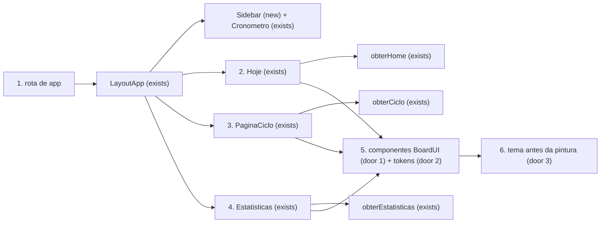

**Changes underneath**

| Front | What changes |
| --- | --- |
| domain | nenhum termo muda de sentido; "Nesta semana" usa a semana de segunda a domingo em Brasília, a mesma das Estatísticas |
| stored data | nada a migrar - leitura apenas; o tema escolhido fica no `localStorage` do aparelho |
| readers | `obterHome` ganha indicadores (lido por `Hoje` e pelo `LayoutApp`); `obterCiclo` ganha progresso e Volta (lido por `PaginaCiclo`); `obterEstatisticas` ganha a variação (lido por `Estatisticas`) |

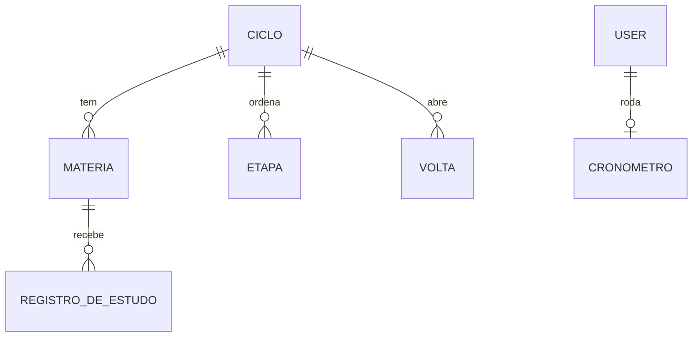

New: nothing - read only.

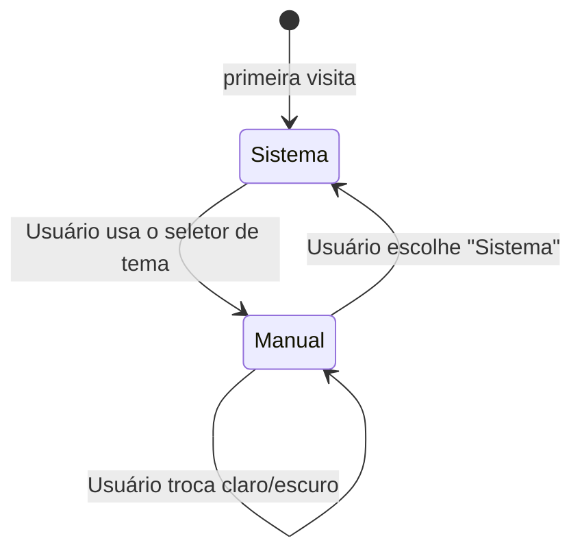

## Surface

None - nothing consumed outside. As rotas, as server actions e as respostas continuam as mesmas.

## Landing

| One-way door | Literal shape | Alternative rejected |
| --- | --- | --- |
| 1. dependências do BoardUI | `react-aria-components`, `@remixicon/react`, `tailwind-merge` e a fonte Inter (`next/font/google`); componentes instalados por `init_boardui` + `install_components` no caminho do `boardui.json`, regras do BoardUI no `AGENTS.md` | reescrever os componentes à mão só com os tokens - mais código e deriva do Figma; o projeto já tem componentes de cliente, então zero JS não é um requisito |
| 2. tokens | só os tokens semânticos do BoardUI existem; `paper`, `surface`, `surface-2`, `ink`, `ink-2`, `line`, `accent*` e as classes `btn`, `panel`, `bar`, `nav-*` são apagados, sem apelido | mapear os tokens antigos como apelidos dos novos - mantém os dois design systems convivendo |
| 3. tema | classe `dark` no `<html>`; chave `tema` no `localStorage` com `"claro"` ou `"escuro"`, ausente = segue `prefers-color-scheme`; o modo claro usa os valores do modo "Claro suave" do Figma (AD-002) | o `ThemeToggle` padrão do BoardUI, que ignora o sistema |
| 4. referência visual | `prototype/` apagado; `docs/design-system.md` reescrito; a regra de interface do `AGENTS.md` aponta para o Figma (`ig7Pq2uPxPWjeWuCKmTuBW`) e diz que o Figma vence | manter o protótipo - a regra atual faria o próximo agente seguir o visual antigo |

- Nothing else in this change is hard to reverse

## Criteria

### S1: Fundação BoardUI (P1)

O app inteiro usa os tokens, a tipografia e o tema do BoardUI.

**Acceptance Criteria**

1. The app SHALL render all text in Inter, and no file under `src/` SHALL reference the tokens or classes listed in Landing door 2
2. WHILE no `tema` is stored and the OS prefers light THEN the system SHALL render `background/full` as `#ebebe8` and `text/primary` as `#1c1c1b` (Claro suave, AD-002)
3. WHILE no `tema` is stored and the OS prefers dark THEN the system SHALL render the BoardUI Dark values, with the `dark` class present in the server-sent HTML before the first paint (no light flash)
4. WHEN the Usuário picks "Claro" or "Escuro" in the theme toggle THEN the system SHALL apply it at once and SHALL keep it on reload in that browser, whatever the OS prefers
5. WHEN the Usuário picks "Sistema" in the theme toggle THEN the system SHALL remove `tema` and follow `prefers-color-scheme` again, including a live OS change
6. The PWA `theme-color` meta SHALL match `background/full` of the active theme

### S2: Sidebar e barra de abas (P1)

A navegação e o Cronômetro do Figma em todas as rotas de `(app)`.

**Acceptance Criteria**

7. WHEN the Usuário opens any `(app)` route at a width ≥ 1024px THEN the system SHALL show the Sidebar of `captures/hoje-claro-suave.png` with Hoje, Estatísticas, the section "Ciclos" listing each Ciclo by name plus a "+" that opens `/ciclos/novo`, Usuários (Admin only), Sair and the Usuário card with name, e-mail and the "Admin" chip for an Admin, without Revisões, Registros and Arquivados (AD-001)
8. WHEN the Usuário is on a route THEN the system SHALL mark its Sidebar item (or tab) as selected with `aria-current="page"`; on `/ciclos/[id]` the item of that Ciclo is the selected one
9. WHILE a Cronômetro is running or paused, the Sidebar SHALL show the Cronômetro card with the time, "<Matéria> · <Ciclo>", the chip "Rodando" or "Pausado", and the buttons "Pausar"/"Retomar" and "Parar"; WHILE no Cronômetro exists the card SHALL be absent
10. WHEN the Usuário opens any `(app)` route at a width < 1024px THEN the system SHALL hide the Sidebar and show the bottom tab bar of `captures/pwa-hoje.png` with Hoje, the central "+" button and Estatísticas (AD-001), and the avatar at the top right
11. WHEN the Usuário taps the "+" tab THEN the system SHALL open Registrar estudo (S5) with the Próxima etapa of the first Ciclo selected
12. WHEN the Usuário taps the avatar on mobile THEN the system SHALL open a menu with the Ciclos, "Novo ciclo", Usuários (Admin only), the theme toggle and Sair
13. WHILE a Cronômetro runs at a width < 1024px on a route other than `/`, the system SHALL show a compact bar above the tab bar with the time, the Matéria and "Parar"
14. WHEN the Usuário uses "Sair" THEN the system SHALL end the session and show `/entrar`, as today

### S3: Hoje (P1)

`/` como os frames Hoje e PWA — Hoje.

**Acceptance Criteria**

15. WHEN the Usuário opens `/` at 1440px THEN the system SHALL show the screen in `captures/hoje-claro-suave.png` (and `captures/hoje-escuro.png` in the dark theme), minus the "Revisões de hoje" card and indicator (AD-003); the Ciclos ativos column then takes the full width
16. WHEN the Usuário opens `/` at 390px THEN the system SHALL show the screen in `captures/pwa-hoje.png`, with the indicators Hoje, Questões and Semana in place of Hoje, Revisões and Acerto (AD-003), and the large Cronômetro card on top while one exists
17. The indicator "Estudado hoje" SHALL sum the duration of every Registro de estudo dated today in Brasília, across all Ciclos, and show the difference from yesterday as a chip
    - 1h10 today and 0h45 yesterday → "1h10" and chip "+25min"; registro at 23:50 of yesterday in Brasília → not counted today; nothing today → "0h", no chip
18. The indicator "Questões hoje" SHALL show today's total questões and the chip "<n>% de acerto" with acertos/questões rounded; with 0 questões today it SHALL show "0" and no chip
    - 20 questões, 16 acertos → "20" and "80% de acerto"; 3 questões, 2 acertos → "67% de acerto"
19. The indicator "Nesta semana" SHALL sum the current week (Monday to Sunday, Brasília) and show the change against the previous full week as "+N%"/"−N%"; with 0 last week it SHALL show no chip
    - 11h40 now, 10h25 before → "+12%"; 5h now, 10h before → "−50%"
20. The Ciclo card SHALL show name, "Volta N", the bar and "
% · <feito> de <carga>", and the Próxima etapa block with its own bar, "Registrar" and "Iniciar"; an Etapa whose Matéria has horas extras SHALL show the chip "+<tempo> extra"
21. WHEN the Usuário uses "Iniciar" on a Próxima etapa THEN the system SHALL start the Cronômetro on that Matéria and show it in the Sidebar; IF a Cronômetro already exists THEN the system SHALL show "Já existe um cronômetro rodando. Pare ou descarte antes de iniciar outro."
22. WHEN the Usuário uses "Registrar" on a Próxima etapa THEN the system SHALL open Registrar estudo with that Matéria selected
23. WHEN the Usuário uses the arrow on a Ciclo card THEN the system SHALL open `/ciclos/<id>`
24. IF the Usuário has no Ciclo THEN `/` SHALL show an empty state with "Criar ciclo" linking to `/ciclos/novo` and no indicators

### S4: Ciclo (P1)

`/ciclos/[id]` como o frame Ciclo — Etapas, sem o disco, e `/ciclos/novo` nos componentes do BoardUI.

**Acceptance Criteria**

25. WHEN the Usuário opens `/ciclos/<id>` at 1440px THEN the system SHALL show the screen in `captures/ciclo.png` minus the tabs, "Reiniciar volta", "Arquivar", the "Faixas de acerto" card and the "Tópicos estudados" column (AD-001)
26. The header SHALL read "<n> etapas · <m> matérias · <carga total> por volta"; the Volta card SHALL show "Volta N", the start line of AD-005, "
% · <feito> de <carga>", "Faltam <tempo>" and "Horas extras <tempo>"
    - Volta 3 opened 2026-11-02, today 2026-11-16 → "Iniciada em 2 de novembro · há 14 dias"; Volta 1 → "Primeira volta"
27. The EtapaRow SHALL show the drag handle, position, Matéria, carga, the bar with percent and one Situação chip: "Concluída" (100%), "Próxima etapa" (the Próxima etapa, row highlighted), "Em andamento" (> 0%), "Não iniciada" (0%), or "+<tempo> extra" for a 100% Etapa whose Matéria has horas extras
28. WHEN the Usuário drags an EtapaRow to a new position THEN the system SHALL save the new order and keep it on reload, as today
29. WHEN the Usuário uses "Adicionar etapa" THEN the system SHALL open a modal with "Nome da matéria" and "Carga horária (h)" and, on save, show the new EtapaRow at the end
30. WHEN the Usuário uses the row menu (⋮) of an Etapa THEN the system SHALL offer "Editar" (modal with the same fields, saved in place) and "Remover etapa", which asks to confirm before removing
31. WHEN the Usuário uses "Renomear" next to the Ciclo name THEN the system SHALL let them edit and save the name, as today (AD-001)
32. The side card "Matérias" SHALL list each Matéria with "<n> etapa(s) · <carga>" and a bar of its progress in the Volta; at < 1024px it SHALL move below the Etapas list
33. IF the Ciclo has no Etapa THEN the list SHALL show an empty state with "Adicionar etapa"
34. IF the Ciclo is not the Usuário's THEN the system SHALL answer 404, as today
35. WHEN the Usuário opens `/ciclos/novo` THEN the system SHALL show the form in a card with the BoardUI Input and Button, and the same validation messages as today

### S5: Registrar estudo (P1)

O formulário de Registro de estudo como o modal do Figma.

**Acceptance Criteria**

36. WHEN the Usuário uses "Registrar estudo" THEN the system SHALL show the modal in `captures/registrar-estudo.png` with Matéria, Conteúdo, Data, Duração, Tipo de estudo, Questões, Acertos, Acerto and Anotação, minus "Tópico", "Nota da revisão" and "Próxima revisão estimada" (AD-001); Conteúdo is the free-text field and Duração keeps Horas and Minutos side by side
37. WHEN the Usuário uses "Parar" on the Cronômetro THEN the system SHALL open the modal with the duration filled in and the note "Duração preenchida pelo cronômetro"
38. WHEN the Usuário types Questões and Acertos THEN the field "Acerto" SHALL show acertos/questões rounded, as "80%" for 16 of 20, and "—" while Questões is empty or 0
39. IF the Usuário saves with Acertos greater than Questões THEN the system SHALL keep the modal open and show the server's message under the field, in the Input error style
40. WHEN the Usuário uses "Salvar registro" with valid data THEN the system SHALL close the modal and the Hoje SHALL show the new totals; "Cancelar", the "×" and Esc SHALL close it without saving
41. WHILE the width is < 1024px the modal SHALL open as a sheet from the bottom, full width

### S6: Estatísticas (P1)

`/estatisticas` como o frame do Figma.

**Acceptance Criteria**

42. WHEN the Usuário opens `/estatisticas` THEN the system SHALL show the screen in `captures/estatisticas.png`, with the change chip only on "Nesta semana" and in "Horas por semana" (AD-004)
43. WHEN the Usuário picks a Ciclo in the segmented control ("Todos os ciclos" plus one segment per Ciclo) THEN every card and chart SHALL show only that Ciclo, as the current filter does
44. The weekly change SHALL be (current − previous) / previous, rounded, from the last two weeks of the existing "horas por semana"
    - 11h40 vs 10h25 → "+12%"; 0h vs 2h → "−100%"; previous 0h → no chip
45. IF there is no Registro de estudo in the filter THEN the system SHALL show an empty state with "Registrar estudo" and no zeroed charts
46. The system SHALL show a Matéria with no questões in "Horas por matéria" and SHALL NOT show it in "Acerto por matéria", as today
47. WHILE the width is < 1024px the cards SHALL stack in one column

### S7: Conta e Usuários (P2)

As rotas de `(conta)` no AuthCard e `/usuarios` na Table.

**Acceptance Criteria**

48. WHEN a visitor opens `/entrar` THEN the system SHALL show the screen in `captures/entrar.png`
49. WHEN a visitor opens `/cadastrar`, `/esqueci-senha` or `/redefinir-senha` THEN the system SHALL show the same AuthCard as `/entrar`, with that page's current fields, messages and links
50. IF SMTP is not configured THEN `/entrar` SHALL NOT show "Esqueci minha senha", as today; IF sign-up is closed THEN `/cadastrar` SHALL show the current notice inside the AuthCard
51. WHEN the Admin opens `/usuarios` THEN the system SHALL list the Usuários in a BoardUI Table with name, e-mail and the "Redefinir senha" action, which opens the current form inline in that row; a non-Admin SHALL be refused as today

### S8: Design system (P2)

Os documentos que dizem como fazer interface passam a apontar para o Figma.

**Acceptance Criteria**

52. The repository SHALL NOT contain `prototype/`
53. The document `docs/design-system.md` SHALL describe the BoardUI semantic tokens with the Claro suave and Escuro values, the type scale, the components of Landing door 1, the product components (Sidebar, StatCard, EtapaRow) and the 1024px breakpoint, and SHALL NOT mention Geist, the disco do ciclo or the old tokens
54. The interface rule in `AGENTS.md` SHALL point to the Figma file `ig7Pq2uPxPWjeWuCKmTuBW` and say that, when Figma and the document differ, Figma wins and the document is corrected in the same PR

## Out of scope

| Excluded | Why |
| --- | --- |
| Revisões, histórico de Registros, Tópicos, Ciclo arquivado, Faixas de acerto | AD-001 - entram pelas issues #5, #7, #10, #11, #12 já no visual novo |
| Reiniciar volta e Arquivar ciclo | AD-001 - não existem no app |
| Abas Matérias, Voltas e Faixas de acerto do Ciclo | AD-001 - dependem das issues #6 e #10 |
| Testes de interface (componentes, E2E) | o repositório só testa casos de uso; as telas são conferidas contra as capturas |

## Assumptions

| Assumption | Chosen default | Rationale | Confirmed? |
| --- | --- | --- | --- |
| Largura em que a Sidebar vira barra de abas | 1024px | user: "Queros os padros do fimga" - o Figma desenha computador a 1440px e celular a 390px | y |
| Cronômetro no celular fora da Hoje | faixa compacta acima da barra de abas | user: "Queros os padros do fimga"; é o comportamento atual | y |
| Telas sem frame (Cadastrar, Esqueci senha, Redefinir senha, Usuários) | AuthCard de Entrar e Table do BoardUI | user: "Queros os padros do fimga" | y |
| Onde ficam Ciclos, Usuários, tema e Sair no celular | menu do avatar no topo, já desenhado no frame PWA | a barra de abas do Figma só tem lugar para Hoje, + e Estatísticas depois do AD-001 | n |
| Diferença de "Estudado hoje" | contra ontem, em tempo ("+25min") | o Figma mostra "+25min" sem dizer a base | n |
| Ação do "+" central | Registrar estudo com a Próxima etapa do primeiro Ciclo | o "+" do Figma fica entre as abas, como o botão "Registrar estudo" do computador | n |

**Open questions:** none - all resolved or logged above.

## Differences from the source

| Source shows | Product shows | Confirmed |
| --- | --- | --- |
| Revisões, Registros e Arquivados na Sidebar; Revisões e Registros na barra de abas | nada | y - AD-001 |
| Card "Revisões de hoje" e indicador "Revisões" na Hoje | nada; no celular, o indicador "Semana" | y - AD-003 |
| Tom claro "Light" do BoardUI | Claro suave | y - AD-002 |
| Abas, "Reiniciar volta", "Arquivar", card "Faixas de acerto" e "Tópicos estudados" no Ciclo | nada; "Renomear" ao lado do nome | y - AD-001 |
| "Iniciada em ..." em qualquer Volta | "Primeira volta" na Volta 1 | y - AD-005 |
| Conteúdo com "Tópico", "Nota da revisão" e "Próxima revisão estimada" no modal; Duração em um campo | só o texto livre; Horas e Minutos lado a lado | y - AD-001 |
| Variação em "Acerto geral" e "Questões" nas Estatísticas | sem variação | y - AD-004 |

## Sources

- `.design/interface-boardui.md` - binding - a decisão da troca, as fatias e as decisões-chave
- Figma "Estudo Livre — BoardUI" (https://www.figma.com/design/ig7Pq2uPxPWjeWuCKmTuBW), exportado em 2026-11-16 - binding - todas as telas abaixo
- 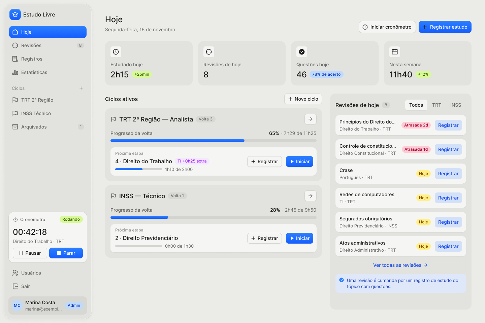 - binding - Hoje no computador, tema claro (AD-002)
- 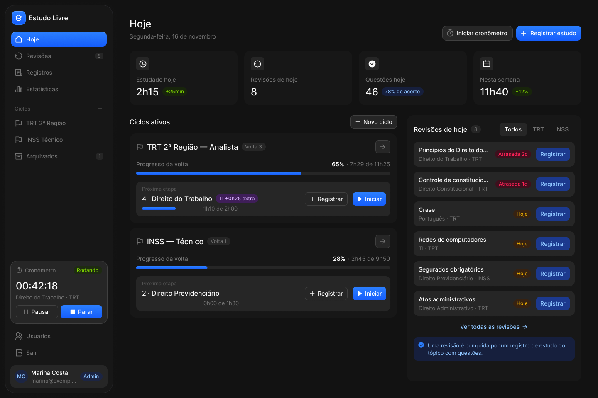 - binding - Hoje no tema escuro
- 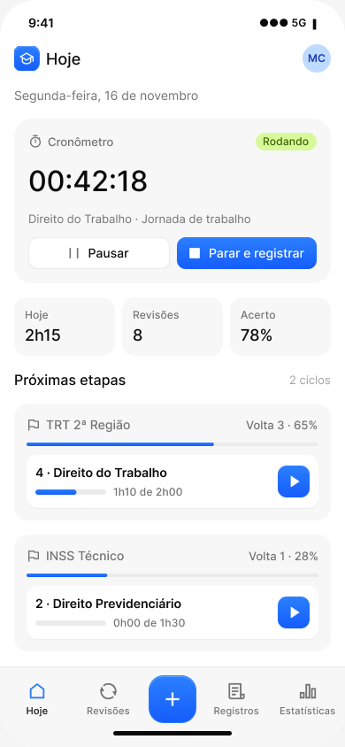 - binding - Hoje no celular, barra de abas, Cronômetro grande
- 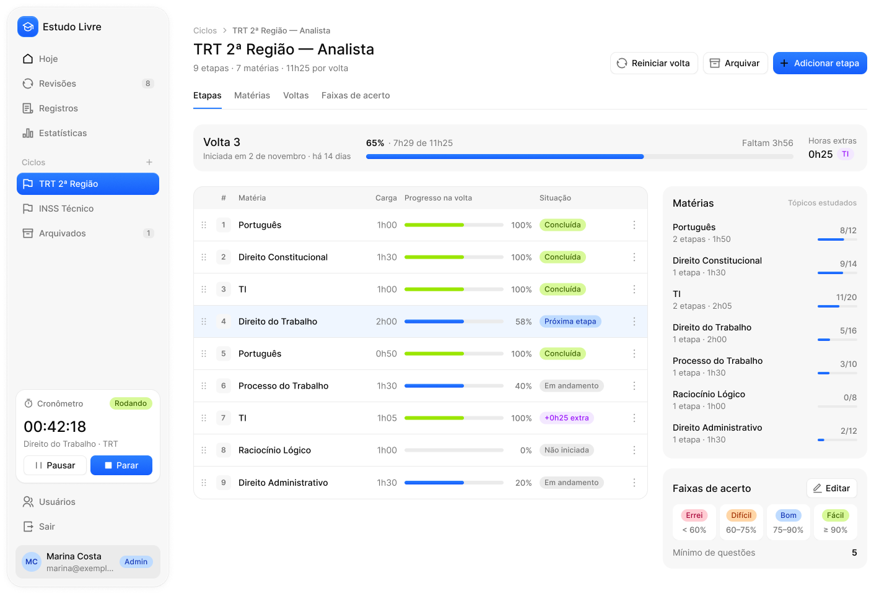 - binding - tela do Ciclo
- 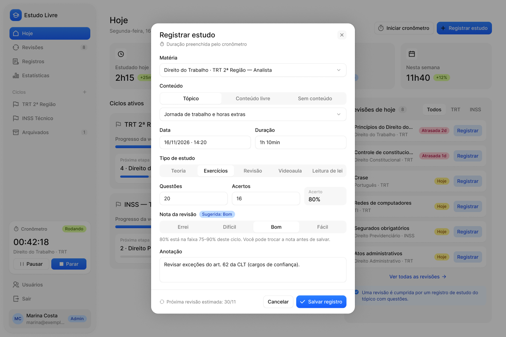 - binding - modal de Registro de estudo
- 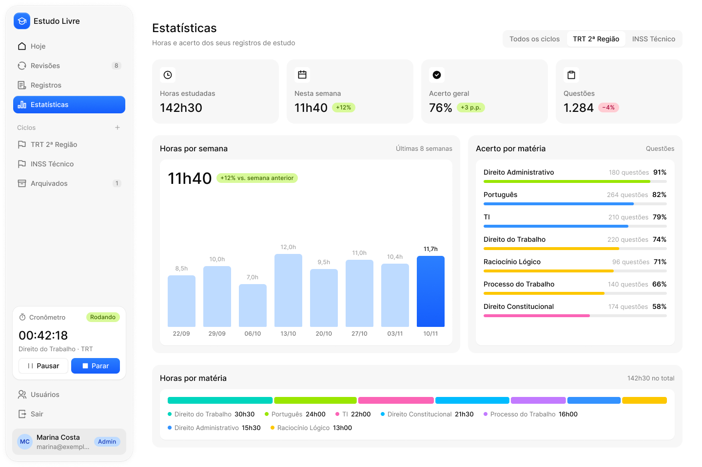 - binding - Estatísticas
- 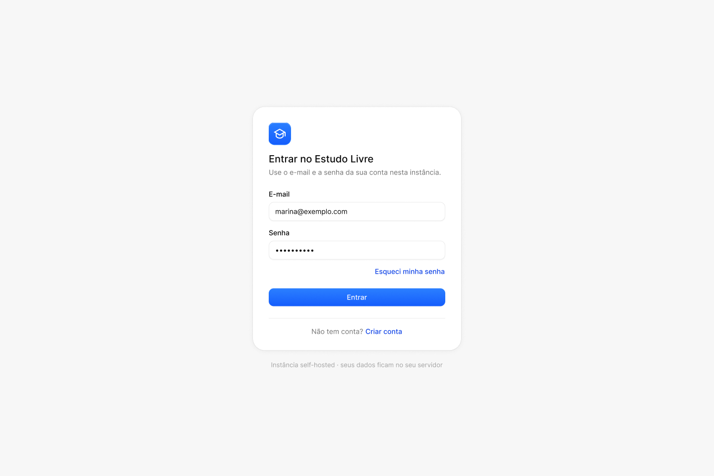 - binding - AuthCard das rotas de conta
- 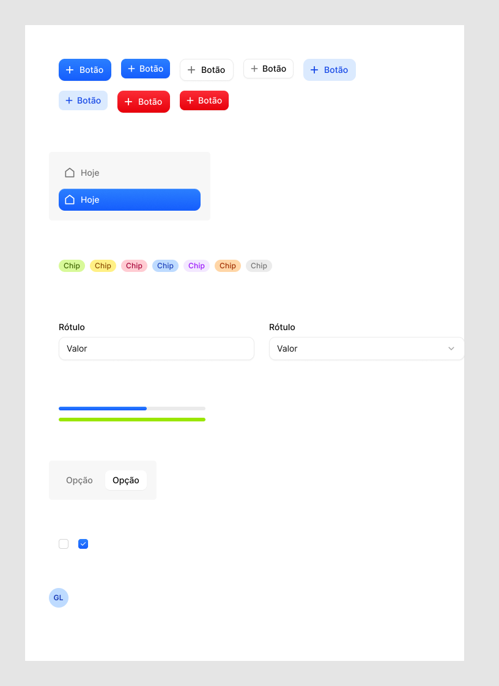 - binding - Button, NavItem, Chip, Input, Progress, Segment, Checkbox, Avatar, Sidebar, StatCard, EtapaRow
