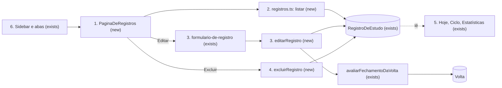
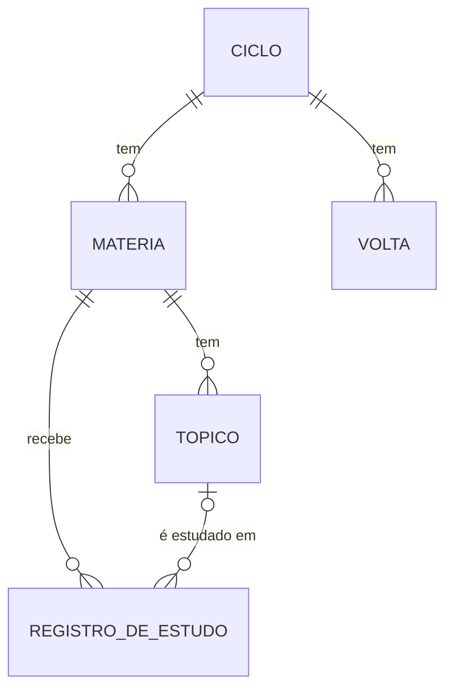
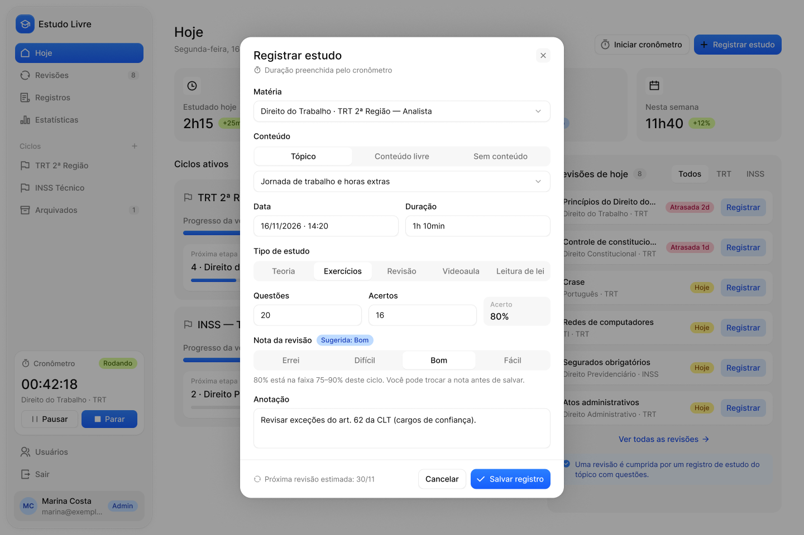

# Registros

**Approved**: 2026-11-17 - user: "Aprovado, pode implementar"

> Build this with **tlc-implement**. Every criterion becomes a check with a proof; nothing under
> the open questions is settled while building.

## Problem

Issue #5. Um Registro de estudo só se cria: depois de salvo o Usuário não vê onde ele está, não corrige uma duração ou uma data errada e não apaga um lançamento duplicado. A única forma de ver o que já estudou são os totais da Hoje, das Estatísticas e do Ciclo, e o único jeito de errar sem volta é lançar o dado errado. Hoje o formulário já aceita uma data no passado, mas o Usuário não tem como saber em qual Volta aquele Registro caiu. Não há número medido: a instância tem um único Usuário.

Quando isto entrar, o Usuário abre "Registros", vê o histórico filtrável por Ciclo e Matéria com a Volta de cada Registro, edita e exclui Registros, lança estudo de dias passados, e o progresso da Volta aberta acompanha cada mudança.

## Shape

Reusa o modal de "Registrar estudo" (`formulario-de-registro`), a validação de `registrarEstudo`, a trava do Ciclo e `avaliarFechamentoDaVolta`, mais `Table`, `Select`, `Chip` e `AlertDialog` do BoardUI. As regras que mudam o que o Usuário vê (filtro, ordem, paginação, Volta de cada Registro, editar, excluir, fechamento) rodam em `src/casos-de-uso`, a camada que o Vitest alcança; as telas só formatam.

1. `GET /registros?ciclo=&materia=&limite=` -> `PaginaDeRegistros` (new) - lê a lista pelo caso de uso e a mostra
2. `PaginaDeRegistros` -> `registros.ts` (new) - filtra por Ciclo e Matéria do Usuário, ordena do mais recente ao mais antigo, corta em `limite` (25 por vez, AD-014) e acha a Volta de cada Registro pela data (AD-012)
3. "Editar" -> modal de `formulario-de-registro` (exists) preenchido -> ação (new) -> `editarRegistro` (new) - valida como `registrarEstudo`, trava o Ciclo (os dois, se a Matéria mudou), grava, marca o Tópico novo como estudado e reavalia o fechamento da Volta aberta de cada Ciclo tocado
4. "Excluir" -> `AlertDialog` -> ação (new) -> `excluirRegistro` (new) - trava o Ciclo, remove o Registro; Tópico estudado não muda (AD-009)
5. out: `revalidatePath("/", "layout")`; Hoje, Ciclo e Estatísticas (exists) leem `registro_de_estudo` na próxima requisição
6. Sidebar e barra de abas (exist) ganham o item "Registros"

**Changes underneath**

| Front | What changes |
| --- | --- |
| domain | "Registro de estudo" deixa de ser só criável: passa a poder ser editado e excluído. Quem lê a lista de Registros hoje: ninguém (só somas). A Volta de um Registro continua sendo derivada da data dele contra `(inicio, fim]` (nada gravado) |
| stored data | nada: sem tabela, coluna ou migração. Registros existentes aparecem no histórico como estão |
| readers | Hoje (Estudado hoje, Questões hoje, Nesta semana), tela do Ciclo (progresso e próxima etapa) e Estatísticas somam `registro_de_estudo`: mudam na hora com cada edição ou exclusão, sem código novo neles (critério 34). Sidebar e barra de abas ganham o item "Registros" (critério 9) |

New: nothing - sem entidade nova; a Volta de um Registro é calculada na leitura. One-way constraints: nenhuma nova.

## Surface

| Route | In | Out | Status | Who |
| --- | --- | --- | --- | --- |
| `GET /registros` | `ciclo`, `materia`, `limite` (query, opcionais) | página "Registros" com a lista e os filtros | 200; 307 redirect ao login sem sessão | o Usuário logado, só os dados dele; sem sessão vai ao login |

## Landing

None - nenhuma tabela, coluna, contrato consumido ou dependência nova. A regra mais difícil de desfazer, a Volta fechada nunca reabrir, é a AD-010 em `.specs/STATE.md`.

## Criteria

### S1: Histórico de Registros com filtro (P1)

O Usuário abre "Registros" e vê, do mais recente ao mais antigo, o que estudou, filtrando por Ciclo e Matéria.

**Acceptance Criteria**

1. WHEN o Usuário usa o item "Registros" da Sidebar (≥ 1024px) ou da barra de abas (< 1024px) THEN o sistema SHALL abrir `/registros` com o título "Registros" e o item marcado como página atual (`aria-current="page"`)
   - a barra de abas segue com o "+" central que registra estudo e Hoje e Estatísticas; "Registros" entra como aba, sem tirar nenhuma
2. WHEN o Usuário abre `/registros` THEN o sistema SHALL listar os Registros de todos os Ciclos dele do mais recente ao mais antigo (data decrescente; empate pelo criado por último primeiro), cada linha com: data (dd/mm/aaaa), Matéria e Ciclo, Volta ("Volta N"), tipo de estudo num `Chip`, duração (`tempo`), questões e acertos com o percentual quando há questões, e o conteúdo (nome do Tópico, o Conteúdo livre ou "—"), mais os botões "Editar" e "Excluir"
   - Registro de 70 min, 20 questões, 16 acertos, Tópico "Jornada de trabalho e horas extras" → "1h10", "16/20 · 80%", o nome do Tópico
3. WHEN a lista tem mais de 25 Registros THEN o sistema SHALL mostrar os 25 mais recentes e, abaixo, o botão "Carregar mais", que acrescenta os 25 seguintes sem perder os já mostrados; o botão SHALL sumir quando não há mais Registros
   - 60 Registros → 25, depois 50, depois 60 sem o botão; exatamente 25 → 25 sem o botão
4. WHILE a lista tem Registros THE página SHALL mostrar "N registros" com o total do filtro atual (singular com 1: "1 registro")
5. WHEN o Usuário escolhe um Ciclo no `Select` "Ciclo" (padrão "Todos os ciclos") THEN o sistema SHALL listar só os Registros das Matérias desse Ciclo, e o `Select` "Matéria" SHALL passar a listar só as Matérias dele
6. WHILE o filtro Ciclo é "Todos os ciclos" THE `Select` "Matéria" SHALL ficar desabilitado com "Todas as matérias"
7. WHEN o Usuário escolhe uma Matéria THEN o sistema SHALL listar só os Registros dela; WHEN troca o Ciclo THEN a Matéria SHALL voltar a "Todas as matérias"
8. WHEN o Usuário muda um filtro THEN a URL SHALL ganhar `?ciclo=<id>&materia=<id>` e abrir a mesma URL SHALL mostrar a mesma lista; a paginação recomeça nos 25 primeiros
9. IF o Usuário não tem nenhum Registro THEN a página SHALL mostrar "Nenhum registro de estudo ainda." e SHALL NOT mostrar a tabela nem "Carregar mais"; IF há Registros mas o filtro não casa nenhum THEN SHALL mostrar "Nenhum registro com este filtro." e o botão "Limpar filtros", que volta a "Todos os ciclos"
10. IF `ciclo` ou `materia` na URL é de outro Usuário, de outro Ciclo ou não existe THEN a página SHALL responder 200 como "Nenhum registro com este filtro." e SHALL NOT mostrar nenhum dado de outro Usuário
11. WHEN o Usuário abre `/registros` em 375px, 768px e 1440px THEN a página SHALL rolar na vertical sem rolagem horizontal da página, com "Editar" e "Excluir" alcançáveis em cada Registro e nos tokens BoardUI com o vocabulário do `CONTEXT.md`
12. WHEN um Registro cai no período de uma Volta THEN a coluna Volta SHALL mostrar o número dela (AD-012); a Volta é a que contém a data do Registro em `(inicio, fim]`, e a Volta 1 não tem início
    - Volta 1 fechada em 10/11 às 15:00 (Brasília): Registro de 10/11 → "Volta 1"; Registro de 11/11 → "Volta 2"; Registro de 05/09 → "Volta 1"

### S2: Editar um Registro (P1)

**Acceptance Criteria**

13. WHEN o Usuário usa "Editar" numa linha THEN o sistema SHALL abrir o modal de `.specs/features/registros/captures/registrar-estudo.png` com título "Editar registro" e o botão primário "Salvar" no lugar de "Salvar registro" (AD-013), os campos preenchidos com o Registro e os mesmos campos do frame com Horas e Minutos separados e Data sem hora (AD-001, AD-007)
    - a linha "Duração preenchida pelo cronômetro", a "Nota da revisão" e a "Próxima revisão estimada" do frame continuam fora (AD-001)
14. WHEN o modal de edição abre THEN o segmento Conteúdo SHALL abrir em "Tópico" com o Tópico escolhido se o Registro tem um, em "Conteúdo livre" com o texto se tem, e em "Sem conteúdo" se não tem nenhum; as demais regras do segmento são as do registro (Tópicos da Matéria escolhida, "Escolha um tópico.", "Esta matéria ainda não tem tópicos.")
15. WHEN o Usuário muda campos e usa "Salvar" THEN o sistema SHALL gravar o Registro com os valores novos, fechar o modal e mostrar a linha atualizada na mesma lista, na mesma posição que a nova data lhe dá
    - 60 min → 90 min, outras coisas iguais → a linha mostra "1h30"
16. WHEN o Usuário muda a Matéria no modal THEN o sistema SHALL mover o Registro para a nova Matéria, inclusive de outro Ciclo; as horas saem do progresso do Ciclo antigo e entram no do novo; o Tópico escolhido SHALL ser limpo e só valer se for da nova Matéria
17. IF o pedido de edição traz Tópico de outra Matéria, de outro Usuário, ou Tópico e Conteúdo livre juntos THEN `editarRegistro` SHALL recusar ("Escolha um tópico desta matéria."; "Escolha um tópico ou digite um conteúdo, não os dois.") e não gravar
18. IF os acertos passam do total de questões THEN `editarRegistro` SHALL recusar com "Os acertos não podem passar do total de questões." sob o campo Acertos e não gravar; IF há acertos sem questões THEN SHALL recusar com "Informe as questões para registrar os acertos."
    - 20 questões e 21 acertos → recusa; 20 e 20 → aceita; 0 questões e 0 acertos → aceita
19. IF a duração (Horas e Minutos juntos) não está entre 1 minuto e 24 horas, a data é inválida ou futura, o tipo não é um dos cinco, o Conteúdo livre passa de 200 caracteres, a anotação de 2000 ou as questões não estão entre 0 e 1000 THEN `editarRegistro` SHALL recusar com as mesmas mensagens de `registrarEstudo` e não gravar
20. WHEN o Usuário não muda a Data e salva THEN o sistema SHALL manter o instante original do Registro; WHEN muda a Data para um dia passado THEN SHALL gravar meio-dia de Brasília desse dia; WHEN muda para hoje THEN SHALL gravar o momento atual (a mesma regra de `instanteDoDia`)
    - editar só a duração de um Registro de hoje às 09:12 → continua 09:12; trocar 12/11 por 13/11 → 13/11 12:00
21. WHEN a edição leva o progresso da Volta aberta de um Ciclo a 100% em todas as Etapas THEN o sistema SHALL fechar a Volta e abrir a seguinte, como `registrarEstudo`, e mostrar "Volta N fechada. Volta N+1 começou em <ciclo>."; IF a edição reduz horas THEN SHALL NOT fechar nem reabrir Volta (AD-010)
22. IF o Registro foi excluído ou é de outro Usuário THEN `editarRegistro` SHALL recusar como "não encontrado" ("Não encontramos este registro. Atualize a página.") e não gravar
23. WHEN uma edição grava um Registro com Tópico THEN o sistema SHALL marcar esse Tópico como estudado na mesma transação; o Tópico anterior do Registro e as marcas manuais SHALL ficar como estão (AD-009)

### S3: Excluir um Registro (P1)

**Acceptance Criteria**

24. WHEN o Usuário usa "Excluir" numa linha THEN o sistema SHALL abrir um `AlertDialog` com "Excluir este registro?" e o resumo "<duração> de <Matéria> em <dd/mm/aaaa>. As horas saem do progresso." e os botões "Cancelar" e "Excluir"
25. WHEN o Usuário confirma THEN o sistema SHALL remover o Registro, fechar o diálogo e tirar a linha da lista, atualizando "N registros"; as horas, questões e acertos dele SHALL sair de todos os totais
    - Registro de 60 min na Volta aberta → a Matéria perde 60 min de progresso
26. WHEN o Usuário usa "Cancelar" ou fecha o diálogo THEN o sistema SHALL NOT remover nada
27. WHEN o Usuário exclui um Registro THEN o Tópico dele SHALL continuar estudado (AD-009) e o Cronômetro SHALL ficar como está
28. WHEN o Registro excluído está numa Volta fechada THEN a Volta SHALL continuar fechada, com o mesmo número e o mesmo fim (AD-010), e o progresso da Volta aberta SHALL NOT mudar
29. IF o Registro já foi excluído ou é de outro Usuário THEN `excluirRegistro` SHALL recusar com "Não encontramos este registro. Atualize a página." e não apagar nada

### S4: Registro retroativo conta na Volta da data (P1)

**Acceptance Criteria**

30. WHEN o Usuário registra (ou edita para) um dia passado que cai no período de uma Volta já fechada THEN o sistema SHALL gravar o Registro com essa data, o histórico SHALL mostrá-lo naquela Volta, e o progresso da Volta aberta SHALL NOT ganhar as horas; a Volta fechada continua fechada (AD-010)
    - Volta 1 fechada em 10/11 às 15:00; registrar 90 min em 08/11 → "Volta 1", progresso da Volta 2 igual; registrar 90 min em 11/11 → "Volta 2", progresso da Volta 2 +90 min
31. WHEN o Usuário registra um dia passado dentro da Volta aberta THEN o sistema SHALL somar as horas ao progresso dela e, se isso completa todas as Etapas, fechá-la como hoje
32. IF a data é futura THEN o sistema SHALL recusar com "A data do estudo não pode estar no futuro." (`registrarEstudo` e `editarRegistro`)
33. IF os acertos passam do total de questões THEN `registrarEstudo` SHALL recusar com "Os acertos não podem passar do total de questões." e não gravar (já vale; esta issue o prova também com data retroativa)

### S5: Progresso consistente (P1)

**Acceptance Criteria**

34. WHEN o Usuário edita ou exclui um Registro THEN a Hoje (Estudado hoje, Questões hoje, Nesta semana), a tela do Ciclo (progresso das Etapas, próxima etapa, horas extras) e as Estatísticas SHALL refletir o resultado na próxima carga
    - excluir 60 min de hoje: "Estudado hoje" cai 60 min; editar a data de hoje para ontem tira os 60 min de "Estudado hoje"
35. WHEN duas mudanças simultâneas atingem o mesmo Ciclo (editar, excluir ou registrar) THEN o sistema SHALL serializá-las na trava do Ciclo, sem fechar a mesma Volta duas vezes e sem erro 500; a segunda sobre um Registro já excluído recusa como "não encontrado"
    - o que garante: `for update` no Ciclo (nos dois, em ordem de id, se a Matéria mudou de Ciclo) antes de gravar

## Out of scope

| Excluded | Why |
| --- | --- |
| Reabrir, refazer ou renumerar uma Volta fechada | AD-010 |
| Ver ou ajustar as Voltas (reiniciar, listar) | issue #6 |
| Busca por texto, filtro por data ou por tipo de estudo | a issue só pede Ciclo e Matéria |
| Excluir vários Registros de uma vez, desfazer a exclusão | a issue não pede |
| Cartão de revisão, Nota da revisão, Próxima revisão estimada | issues #10 e #12 (AD-001) |
| Editar o Cronômetro a partir do Registro | o Registro já foi gravado; o Cronômetro é independente |

## Assumptions

| Assumption | Chosen default | Rationale | Confirmed? |
| --- | --- | --- | --- |
| Registro e Tópico estudado | editar ou excluir um Registro não desmarca Tópico | AD-009 diz que a marca é um indicador gravado, que só o Usuário desmarca | n |
| Filtro de Matéria sem Ciclo | `Select` "Matéria" desabilitado até escolher Ciclo | a Matéria é do Ciclo (ADR-0001): nomes iguais em Ciclos diferentes são distintas | n |
| Estado do filtro e do "Carregar mais" | na URL (`ciclo`, `materia`, `limite`) | link estável e recarregável | n |
| Volta de um Registro no limite | pelo instante: meio-dia de Brasília para dia passado, momento atual para hoje, contra `(inicio, fim]` | é a regra que o progresso já usa, então a coluna sempre concorda com ele | n |
| Mensagem de "não encontrado" | "Não encontramos este registro. Atualize a página." | segue "Não encontramos esta matéria. Atualize a página." de `registrar` | n |
| Texto do diálogo de exclusão | "Excluir este registro?" + resumo | o frame não desenha este diálogo | n |
| Onde o modal pega Matérias e Tópicos | do mesmo provedor que o layout já alimenta para "Registrar estudo" | uma fonte só | n |

**Open questions:** none - all resolved or logged above.

## Differences from the source

| Source shows | Product shows | Confirmed |
| --- | --- | --- |
| Título "Registrar estudo" e botão "Salvar registro" | "Editar registro" e "Salvar" quando se edita | y - AD-013 |
| Data "dd/mm/aaaa · hh:mm" | só a data | y - AD-007 |
| Duração em um campo ("1h 10min") | Horas e Minutos separados | y - AD-001 |
| "Duração preenchida pelo cronômetro", "Nota da revisão", "Próxima revisão estimada" | nada | y - AD-001 |
| Sidebar com Revisões (8) e Arquivados | só Hoje, Registros, Estatísticas e os Ciclos | y - AD-001 |

## Sources

- Issue #5 "Editar, excluir e histórico de registros" (GitHub) - binding - critérios de aceite e a seção Interface
-  - binding - exportado do Figma `ig7Pq2uPxPWjeWuCKmTuBW`, 2026-11-17 - modal usado para editar
- `docs/design-system.md` e `.specs/STATE.md` (AD-001, AD-007, AD-009 a AD-014) - binding - estilo, escopo visual e decisões desta issue
