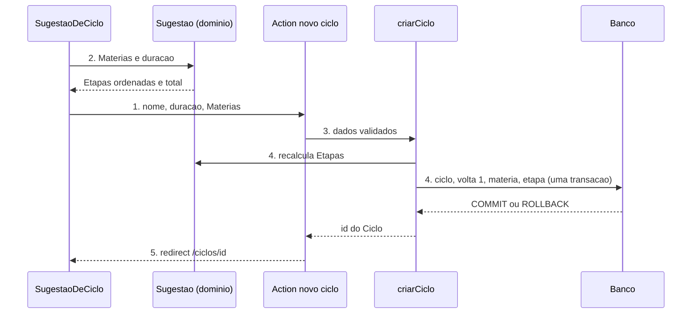
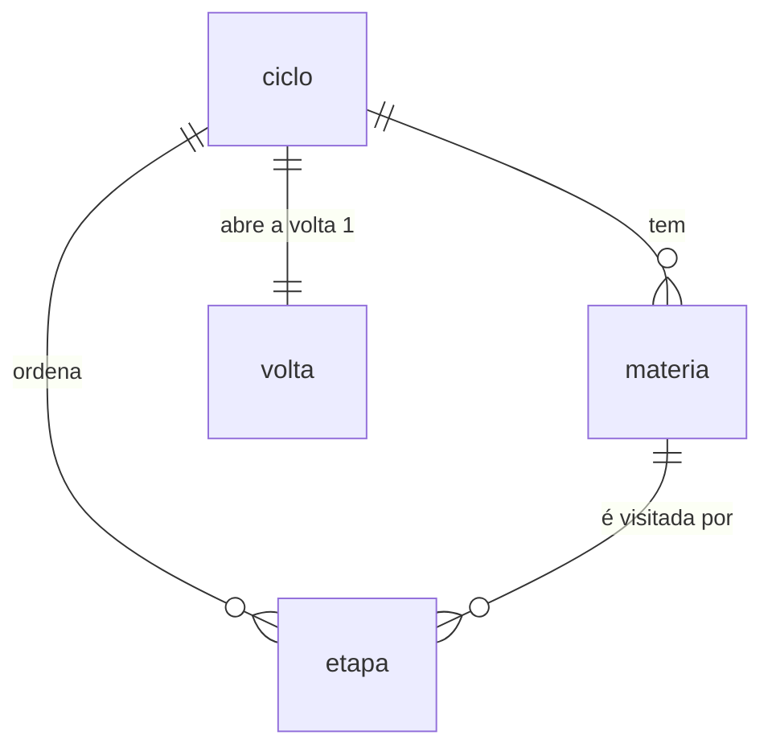

# Sugestão de ciclo

**Approved**: 2026-11-22 - user: "Aprovado, pode implementar"

> Build this with **tlc-implement**. Every criterion becomes a check with a proof; nothing under
> the open questions is settled while building.

## Problem

Hoje criar um Ciclo pede só o nome; as Etapas entram uma a uma, cada uma com a carga horária digitada. Quem quer repartir o tempo pelo número de questões de cada Matéria na prova e pela própria dificuldade na Matéria tem de fazer a conta fora do app: o primeiro ciclo foi montado no app Aprovado e as cargas foram redigitadas aqui. O pedido não traz número medido; é uma instância de um Usuário e o substituto é o app externo.

Quando isto for entregue, o Usuário informa as Matérias com Questões da prova e Dificuldade ao criar o Ciclo, vê as Etapas sugeridas na ordem e cria o Ciclo inteiro no Estudo Livre, sem digitar a carga de cada Etapa.

## Shape

Reaproveita a criação atômica de Ciclo (com a Volta 1) e o vocabulário de Matéria e Etapa, sem criar entidade nova; a regra da sugestão roda no domínio puro (`src/dominio.ts`) e a criação nos casos de uso, as duas camadas que os testes de `tests/` alcançam com banco real.

1. Usuário preenche `/ciclos/novo` (nome, duração da Etapa, Matérias com Questões da prova e Dificuldade) -> `SugestaoDeCiclo` (new) - tela que guarda nome, duração e a lista de Matérias; substitui `FormularioNome` só nesta página
2. "Visualizar ciclo" -> sugestão no domínio (new) - calcula as Etapas ordenadas; só leitura, não grava
3. "Criar ciclo" -> action de `/ciclos/novo` (exists) - valida e entrega ao caso de uso `criarCiclo` (exists)
4. `criarCiclo` (exists) - recalcula as Etapas com a mesma função do passo 2, numa só transação grava `ciclo`, `volta` 1, `materia` e `etapa`
5. out: redirect para `/ciclos/{id}`, onde a página do Ciclo (exists) mostra as Etapas e a Próxima etapa

**Changes underneath**

| Front | What changes |
| --- | --- |
| domain | Nenhum termo muda de sentido. Entram "Dificuldade", "Questões da prova" e "Sugestão de ciclo" no `CONTEXT.md` |
| stored data | `materia` ganha dois campos opcionais; Matérias existentes ficam sem valor, nada a migrar além das colunas (door 1) |
| readers | Backup (exporta e importa os campos, door 2); "copiar matéria" (leva a Dificuldade); nenhuma outra tela lê os campos |

New: nothing - two optional fields on `materia`. One-way constraints: `dificuldade` limitada a `facil`, `media`, `dificil` (door 1).

## Surface

| Route | In | Out | Status | Who |
| --- | --- | --- | --- | --- |
| `/ciclos/novo` (action existente) | `nome`, `horas` (duração da Etapa), lista de Matérias `{nome, questoes, dificuldade}` | redirect para `/ciclos/{id}`; erro `{ erro: string }` | `303` para `/ciclos/{id}`, `200` com `{erro}`, `307` para `/entrar` sem sessão | Usuário com sessão; sem sessão é redirecionado para `/entrar` |

## Landing

| One-way door | Literal shape | Alternative rejected |
| --- | --- | --- |
| 1. Campos em `materia` | `dificuldade` enum `dificuldade_da_materia` (`facil`, `media`, `dificil`), nulo; `questoes_da_prova` integer, nulo | Dificuldade como inteiro 1 a 3 - o backup e quem lê o banco não veem o sentido; guardar o plano no `ciclo` - só vale com rebalanceamento por Volta, que ninguém pediu |
| 2. Formato do backup | versão 1 mantida; por Matéria, `dificuldade` (`"facil"`, `"media"`, `"dificil"` ou `null`) e `questoesDaProva` (inteiro ou `null`), ambos opcionais na importação | Subir para a versão 2 - recusaria os backups já exportados sem ganho |

- Nothing else in this change is hard to reverse: fatores, teto de 8 e duração padrão são regra de cálculo, trocados em código sem tocar dados já gravados (AD-038)

## Criteria

### S1: Criar o ciclo já com Matérias e Etapas sugeridas (P1)

O Usuário monta a lista de Matérias em `/ciclos/novo`, vê as Etapas sugeridas e cria o Ciclo inteiro.

**Acceptance Criteria**

1. WHEN o Usuário abre `/ciclos/novo` THEN the system SHALL mostrar "Nome do ciclo", "Duração da etapa (h)" com o valor "1", a tabela de Matérias sem linhas e o botão "Criar ciclo"
2. WHEN o Usuário digita um nome no campo "Matéria" e usa "Adicionar matéria" THEN the system SHALL acrescentar ao fim da tabela uma linha com esse nome, "Questões" vazio e Dificuldade "Média", e limpar o campo
   - "Língua Portuguesa" → linha nova; campo vazio → nenhuma linha e o erro "Informe o nome da matéria."
3. IF o nome digitado já está na tabela, sem diferenciar maiúsculas, THEN the system SHALL recusar com "A matéria “<nome>” já está na lista." e não acrescentar linha
   - "estatística" com "Estatística" já na lista → recusado
4. WHEN o Usuário usa a lixeira de uma linha THEN the system SHALL remover a linha, sem confirmação e sem gravar nada
5. WHERE a tabela já tem 50 linhas, IF o Usuário usa "Adicionar matéria" THEN the system SHALL recusar com "A sugestão aceita até 50 matérias."
6. WHILE a tabela não tem linhas, WHEN o Usuário usa "Criar ciclo" THEN the system SHALL criar o Ciclo com a Volta 1 aberta, sem Matérias nem Etapas, e ir para `/ciclos/{id}`, como hoje; "Visualizar ciclo" fica desabilitado
7. IF uma linha tem "Questões" vazio, 0, negativo, decimal ou acima de 10.000 THEN the system SHALL recusar "Visualizar ciclo" e "Criar ciclo" com "Informe as questões da prova (inteiro de 1 a 10.000)." sob o campo da linha e não gravar nada
   - 1 → aceito; 10.000 → aceito; 0 → recusado; "7,5" → recusado; 10.001 → recusado
8. IF "Duração da etapa (h)" não é maior que zero ou passa de 10.000 horas THEN the system SHALL recusar com "A carga horária precisa ser maior que zero e no máximo 10.000 horas." e não gravar nada
   - "0,5" → Etapas de 30 minutos; "0" → recusado; "10000" → aceito; "10001" → recusado
9. The system SHALL oferecer as Dificuldades "Fácil", "Média" e "Difícil" em cada linha, com "Média" escolhida ao acrescentar
10. The system SHALL calcular o peso de cada Matéria como Questões da prova × fator, com fator 1 para Fácil, 1,5 para Média e 2 para Difícil
11. The system SHALL dar a cada Matéria um número de Etapas igual ao peso ÷ menor peso da lista, arredondado com meio para cima, no mínimo 1 e no máximo 8
    - menor peso 2 (2 questões, Fácil), Matéria de peso 3 (2 questões, Média) → 3 ÷ 2 = 1,5 → 2 Etapas; peso 100 contra menor 5 → 20 → 8 Etapas; uma só Matéria → 1 Etapa; pesos iguais → o mesmo número de Etapas
12. The system SHALL ordenar as Etapas em rodadas, cada rodada com uma Etapa de cada Matéria que ainda tem Etapas sobrando, da Matéria de maior peso para a de menor, e o empate de peso segue a ordem em que as Matérias foram digitadas
    - TI (50, Difícil), Estatística (7, Difícil), Língua Portuguesa (15, Média), Matemática (5, Difícil), Atualidades (5, Fácil), Conhecimentos Bancários (7, Difícil), Inglês (5, Fácil) → 23 Etapas, nesta ordem: TI, Língua Portuguesa, Estatística, Conhecimentos Bancários, Matemática, Atualidades, Inglês, TI, Língua Portuguesa, Estatística, Conhecimentos Bancários, Matemática, TI, Língua Portuguesa, Estatística, Conhecimentos Bancários, TI, Língua Portuguesa, TI, Língua Portuguesa, TI, TI, TI
13. WHEN o Usuário usa "Visualizar ciclo" com as linhas válidas THEN the system SHALL mostrar as Etapas na ordem sugerida, cada uma com o nome da Matéria e a duração, e a carga total em horas, sem gravar nada
14. WHEN o Usuário usa "Voltar" na visualização THEN the system SHALL mostrar o formulário com o nome, a duração e as linhas exatamente como estavam
15. WHEN o Usuário usa "Criar ciclo" com linhas válidas THEN the system SHALL criar, numa só operação, o Ciclo, a Volta 1 aberta, uma Matéria por linha com Dificuldade e Questões da prova gravadas, e as Etapas sugeridas com a duração informada e posições 0 a N-1 na ordem sugerida, e ir para `/ciclos/{id}`
    - as Etapas criadas são as mesmas que a visualização mostrou para a mesma lista
16. IF qualquer gravação da criação falha THEN the system SHALL não deixar Ciclo, Matéria nem Etapa criados, pela mesma transação única de `criarCiclo`
    - nome de Matéria repetido chegando ao caso de uso → recusado com "A matéria “<nome>” já está na lista." e a contagem de Ciclos do Usuário não muda
17. The system SHALL ignorar Etapas enviadas pelo cliente: o caso de uso recebe só nome, duração e Matérias, e deriva as Etapas
18. IF o nome do Ciclo está vazio THEN the system SHALL recusar com "Informe o nome do ciclo." e não gravar nada, mesmo com linhas na tabela
19. WHILE a criação está sendo enviada THEN the system SHALL manter "Criar ciclo" desabilitado
20. WHEN o Usuário usa a tela a 1440px e a 390px de largura THEN the system SHALL mostrar a tabela com Matéria, Questões e Dificuldade utilizáveis, sem rolagem horizontal da página, e os botões de "Visualizar ciclo" e "Criar ciclo" alcançáveis com 50 linhas

### S2: Backup e cópia preservam os campos novos (P2)

Dificuldade e Questões da prova sobrevivem a exportar, importar e copiar Matéria.

**Acceptance Criteria**

1. WHEN o Usuário exporta o backup THEN the system SHALL incluir em cada Matéria `dificuldade` (`"facil"`, `"media"`, `"dificil"` ou `null`) e `questoesDaProva` (inteiro ou `null`)
2. WHEN o Usuário importa um backup exportado com Matérias que têm os dois campos THEN the system SHALL recriar cada Matéria com os mesmos valores
3. WHEN o Usuário importa um backup versão 1 sem `dificuldade` nem `questoesDaProva` THEN the system SHALL importar normalmente, com os dois campos nulos
4. IF o arquivo traz `dificuldade` fora de `facil`, `media`, `dificil` ou `questoesDaProva` que não seja inteiro de 1 a 10.000 (AD-037) THEN the system SHALL recusar o arquivo com a recusa de arquivo inválido que a importação já tem, sem substituir nenhum Ciclo
   - `"dificil2"` → recusado; `0` → recusado; `2.5` → recusado; `"7"` → recusado; `10001` → recusado; `null` → aceito
5. WHEN o Usuário copia uma Matéria com Dificuldade THEN the system SHALL criar a cópia com a mesma Dificuldade e Questões da prova nulo
6. WHEN o Usuário acrescenta uma Etapa de Matéria nova pelo "Adicionar etapa" THEN the system SHALL criar a Matéria com Dificuldade e Questões da prova nulos

## Out of scope

| Excluded | Why |
| --- | --- |
| Coluna Peso, "Usar pesos e questões" e as carinhas de dificuldade do print | Fora do pedido; `CONTEXT.md` evita "peso" para carga horária |
| Total de horas da volta | O usuário disse para não informar; a escala vem da duração da Etapa |
| "Importar matérias do planejamento" e "Adicionar todas matérias" | Não há planejamento no produto; "copiar matéria" já cobre outro Ciclo |
| Sugerir ou rebalancear um Ciclo que já existe | Só a criação foi pedida |
| Mostrar ou editar Dificuldade e Questões da prova depois da criação | Sem tela; vira issue se fizer falta |
| Escolher a Matéria de uma lista pronta | Não há catálogo; o nome é digitado |

## Assumptions

| Assumption | Chosen default | Rationale | Confirmed? |
| --- | --- | --- | --- |
| Valores da sugestão | Fatores 1, 1,5 e 2; Etapas = peso ÷ menor peso, mínimo 1, máximo 8; duração padrão 1h | AD-038 | y - user: "Aprovado" |
| Dificuldade e Questões da prova ficam na Matéria | Guardadas, opcionais | AD-037 | y - user: "Aprovado" |
| O print do Aprovado é inspiração | Não binding; a tela segue o design system do BoardUI | O pedido diz "mais ou menos da forma que é feita no app aprovado" | y - user: "mais ou menos da forma que é feita no app aprovado" |
| Copiar Matéria leva a Dificuldade e não as Questões da prova | Copia a Dificuldade; Questões da prova nulo | A dificuldade é do Usuário; as questões são da prova do concurso de destino | n |
| Limite de Questões da prova | 1 a 10.000 | Mesmo teto de ordem de grandeza da carga horária; evita valores que estouram o inteiro | n |
| Limite de Matérias na tela | 50 | Pesos e Etapas ficam legíveis; cada Matéria rende até 8 Etapas | n |
| Frame do Figma | Nenhum frame do BoardUI desenha esta tela entre as capturas de `.specs/features/interface-boardui`; seguir os princípios de `docs/design-system.md`, usar os componentes BoardUI já instalados e atualizar o documento no mesmo PR | AGENTS.md: "se nenhum dos dois cobre, siga os princípios do design system e atualize o documento" | n |
| Estados de carregamento e sessão | Reaproveitam a tela atual: botão desabilitado enquanto envia e redirect para `/entrar` sem sessão | Comportamento existente de `FormularioNome` e `exigirUsuario` | y - default of the code |

**Open questions:** none - all resolved or logged above.

## Differences from the source

None - the product matches the source

## Sources

- `.design/sugestao-de-ciclo.md` - binding for the decisions; confirmed by the user on 2026-11-22
- `CONTEXT.md`, `docs/adr/0001-materias-isoladas-por-ciclo.md`, `docs/adr/0004-etapas-separadas-de-materias.md` - vocabulário e regras de Matéria e Etapa
- Print do app Aprovado "Sugerir Ciclo de Estudos" - non-binding - user: "mais ou menos da forma que é feita no app aprovado" - informa a tabela de Matéria, Questões e Dificuldade
