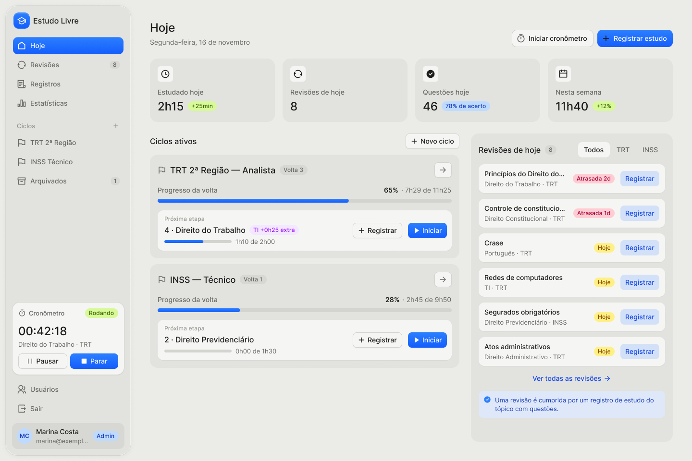
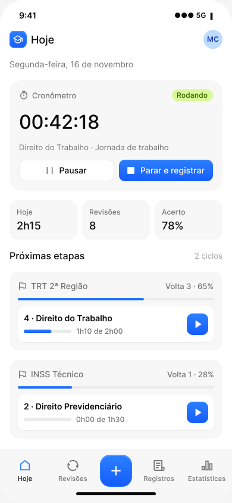
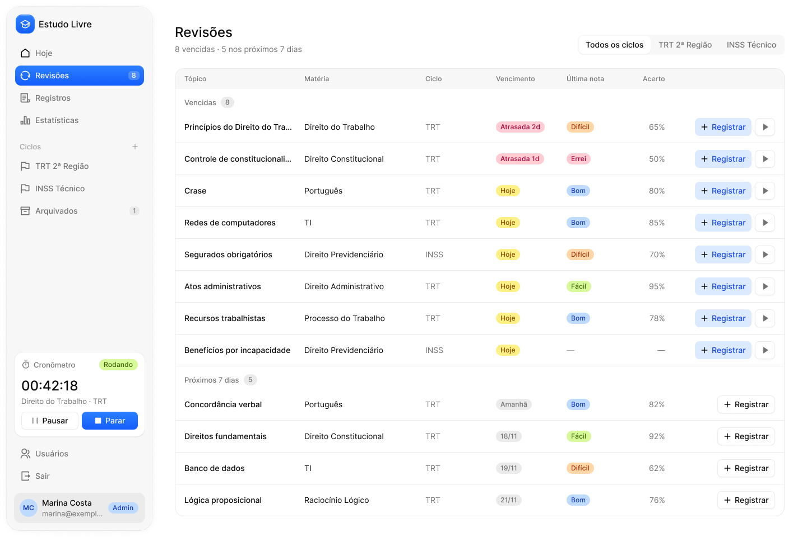

# Tela de revisões Specification

**Approved**: 2026-11-22 - user: "Aprovado"

## Problem Statement

Os Cartões de revisão já agendam cada Tópico (issue #10) e os Ciclos já podem ser arquivados (issue #11), mas nenhuma tela diz ao Usuário o que revisar hoje. Ele precisa ver as Revisões vencidas de todos os Ciclos ativos, filtrar por Ciclo e partir de uma Revisão para registrar o estudo ou iniciar o Cronômetro (issue #12).

## Goals

- [ ] A Hoje mostra o indicador "Revisões de hoje" e o cartão "Revisões de hoje" com as Revisões vencidas, filtráveis por Ciclo.
- [ ] A página `/revisoes` lista as Revisões vencidas e as dos próximos 7 dias de todos os Ciclos ativos, filtráveis por Ciclo.
- [ ] De uma Revisão o Usuário abre o registro com Matéria e Tópico preenchidos ou inicia o Cronômetro nesse Tópico.
- [ ] As Revisões de um Ciclo arquivado somem e voltam intactas quando o Ciclo é reativado.

## Out of Scope

| Feature | Reason |
| --- | --- |
| Alterar o agendamento (FSRS, Faixas, Nota da revisão) | Pronto na issue #10; aqui só se lê o Cartão |
| Adiar, dispensar ou marcar uma Revisão como feita sem Registro | A issue diz que só um Registro com questões conclui a Revisão |
| Notificações ou lembretes fora do app | Não pedido |
| Revisões de Tópicos sem data de próxima revisão | AD-019: o Cartão sem nota não vence |
| Layout da página Revisões abaixo de 1024px, além dos resultados descritos | O Figma só desenha 1440px; vale o design system |

---

## Assumptions & Open Questions

| Assumption / decision | Chosen default | Rationale | Confirmed? |
| --- | --- | --- | --- |
| Quando uma Revisão é vencida | O dia (Brasília) da próxima revisão é hoje ou anterior; "Próximos 7 dias" vai de amanhã até hoje + 7, inclusive | A issue: "próxima data até hoje"; o dia de Brasília é a regra do app (`hojeEmBrasilia`) | y - issue #12 |
| Ordem das listas | Vencimento mais antigo primeiro; empate pelo nome do Tópico | Quem está mais atrasado aparece no topo | y - aprovado pelo usuário |
| Filtro por Ciclo | Um item "Todos os ciclos" mais um por Ciclo ativo, guardado no endereço (`?ciclo=<id>`); um Ciclo desconhecido, de outro Usuário ou arquivado vale "Todos os ciclos" | Compartilhável e sobrevive a recarregar; o filtro é aplicado no servidor | y - aprovado pelo usuário |
| O que o filtro conta | Subtítulo, contadores das seções e do cartão acompanham o filtro; o indicador "Revisões de hoje" e o Counter da Sidebar somam todos os Ciclos ativos | O Figma mostra o contador do cartão ao lado de "Todos"; os totais globais não dependem de tela | y - aprovado pelo usuário |
| Tamanho do cartão da Hoje | Até 6 Revisões, as mais atrasadas; o link "Ver todas as revisões" abre `/revisoes` com o mesmo filtro | O Figma desenha 6 linhas e o link | y - aprovado pelo usuário |
| Indicador no celular | Hoje, Revisões, Questões (Revisões no lugar de Semana, na segunda posição da captura) | A issue manda Revisões no lugar de "Nesta semana"; a posição segue a captura | y - aprovado pelo usuário |
| Revisões no celular | A Hoje não mostra o cartão; elas ficam na página `/revisoes`, pela aba "Revisões" | `captures/pwa-hoje.png` não desenha o cartão | y - captura |
| Sem Revisões | Hoje: "Nenhuma revisão vencida." no cartão; página: "Nenhuma revisão vencida." sob "Vencidas"; "Próximos 7 dias" não aparece se vazio | Estados que a captura não mostra | y - aprovado pelo usuário |
| Contador do item da Sidebar | Só aparece com ao menos uma Revisão vencida, como o de "Arquivados" (AD-026) | O Figma desenha "8" | y - aprovado pelo usuário |
| Revisão cumprida | Salvar um Registro do Tópico com questões recalcula o Cartão (#10); a Revisão sai de "Vencidas" e, se a nova data cai em até 7 dias, entra em "Próximos 7 dias" | Comportamento herdado do Cartão; a tela só relê | y - issue #10 |
| Dados dos chips | "Atrasada Nd" (rosa) com N dias de atraso; "Hoje" (amarelo); "Amanhã" e "dd/mm" (cinza) para os próximos | Os chips do Figma | y - captura |

**Open questions:** none - os padrões foram aprovados com o spec.

---

## User Stories

### P1: Ver as Revisões vencidas na Hoje ⭐ MVP

**User Story**: Como Usuário, quero ver na tela inicial quantas Revisões vencem hoje e quais são, para saber o que revisar sem abrir cada Ciclo.

**Why P1**: É o núcleo da issue.

**Acceptance Criteria**:

1. WHEN o Usuário abre a Hoje em 1440px THEN the system SHALL mostrar a tela de `.specs/features/tela-de-revisoes/captures/hoje.png`: o indicador "Revisões de hoje" na segunda posição e o cartão "Revisões de hoje" na coluna à direita de "Ciclos ativos"
2. The system SHALL contar como Revisão vencida cada Cartão de um Tópico de um Ciclo ativo cujo dia de próxima revisão, em Brasília, é hoje ou anterior
3. The system SHALL mostrar no indicador "Revisões de hoje" o total de Revisões vencidas de todos os Ciclos ativos, sem chip
4. The system SHALL mostrar no cabeçalho do cartão da Hoje o Counter com a quantidade de Revisões vencidas do filtro escolhido
5. The system SHALL mostrar cada Revisão do cartão com o nome do Tópico, "<Matéria> · <Ciclo>", o chip "Atrasada Nd" (N dias de atraso, rosa) ou "Hoje" (amarelo) e o botão "Registrar"
6. The system SHALL listar no cartão as Revisões em ordem do vencimento mais antigo ao mais novo, no máximo 6
7. WHEN o Usuário escolhe um Ciclo no filtro do cartão THEN the system SHALL listar e contar só as Revisões vencidas desse Ciclo
8. WHEN o Usuário escolhe "Todos" no filtro do cartão THEN the system SHALL listar as Revisões vencidas de todos os Ciclos ativos
9. WHEN o Usuário usa "Ver todas as revisões" THEN the system SHALL abrir a página `/revisoes` com o mesmo filtro de Ciclo
10. The system SHALL mostrar no cartão da Hoje o aviso "Uma revisão é cumprida por um registro de estudo do tópico com questões."
11. IF não há Revisão vencida no filtro escolhido THEN the system SHALL mostrar no cartão "Nenhuma revisão vencida." e ocultar "Ver todas as revisões"
12. WHEN o Usuário abre a Hoje em 390px THEN the system SHALL mostrar os indicadores Hoje, Revisões e Questões, sem o cartão "Revisões de hoje", como em `.specs/features/tela-de-revisoes/captures/pwa-hoje.png`

**Independent Test**: Com Tópicos de dois Ciclos vencidos em dias diferentes, abrir a Hoje, ver o contador e a lista, filtrar por um Ciclo e ver a lista e o Counter do cartão mudarem.

---

### P1: Registrar ou cronometrar a partir de uma Revisão ⭐ MVP

**User Story**: Como Usuário, quero partir de uma Revisão para registrar o estudo ou iniciar o Cronômetro já no Tópico certo.

**Why P1**: Sem a ação a lista só informa; a issue pede a ação.

**Acceptance Criteria**:

1. WHEN o Usuário usa "Registrar" numa Revisão THEN the system SHALL abrir o modal "Registrar estudo" com a Matéria e o Tópico da Revisão selecionados e a data de hoje
2. WHEN o Usuário usa o botão ▶ numa Revisão vencida da página Revisões THEN the system SHALL iniciar o Cronômetro na Matéria da Revisão, guardando o Tópico
3. WHEN o Usuário para o Cronômetro que guarda um Tópico THEN the system SHALL abrir o modal de registro com a Matéria, o Tópico e a duração do Cronômetro preenchidos
4. IF já existe um Cronômetro do Usuário, ativo ou pausado, THEN the system SHALL recusar o ▶ com a mensagem "Já existe um cronômetro rodando. Pare ou descarte antes de iniciar outro." e manter o botão habilitado
5. WHEN o Usuário descarta o Cronômetro que guarda um Tópico THEN the system SHALL descartá-lo sem criar Registro, como hoje
6. WHEN um Tópico guardado no Cronômetro é excluído THEN the system SHALL manter o Cronômetro, sem Tópico, e abrir o modal de registro sem Tópico ao pará-lo
7. WHEN o Usuário salva um Registro do Tópico com questões pelo modal aberto por uma Revisão THEN the system SHALL tirar a Revisão de "Vencidas" na lista atualizada
8. WHEN o Usuário salva um Registro do Tópico sem questões THEN the system SHALL manter a Revisão em "Vencidas", pois só um Registro com questões a cumpre

**Independent Test**: Usar "Registrar" numa Revisão e ver o modal com Matéria e Tópico; iniciar o Cronômetro pelo ▶, pará-lo e ver o modal com o Tópico.

---

### P1: Página Revisões ⭐ MVP

**User Story**: Como Usuário, quero uma página com todas as Revisões vencidas e as próximas, filtradas por Ciclo, para planejar a semana.

**Why P1**: O item "Revisões" da Sidebar e da barra de abas abre essa página, e a Hoje liga a ela.

**Acceptance Criteria**:

1. WHEN o Usuário abre `/revisoes` em 1440px THEN the system SHALL mostrar a tela de `.specs/features/tela-de-revisoes/captures/revisoes.png`
2. The system SHALL mostrar o subtítulo "N vencidas · M nos próximos 7 dias" com os totais do filtro escolhido
3. The system SHALL mostrar a seção "Vencidas" com seu Counter e, em cada linha, o Tópico, a Matéria, o Ciclo, o chip de vencimento ("Atrasada Nd" ou "Hoje"), a última nota, o acerto, o botão "Registrar" e o botão ▶
4. The system SHALL mostrar a seção "Próximos 7 dias" com seu Counter e, em cada linha, as mesmas colunas, com o chip "Amanhã" ou "dd/mm" e só o botão "Registrar" neutro
5. The system SHALL mostrar como última nota e acerto os do Registro mais recente do Tópico que gerou nota, e "—" nas duas colunas quando o Tópico não tem nenhum
6. The system SHALL listar cada seção do vencimento mais antigo ao mais novo, com desempate pelo nome do Tópico
7. WHEN o Usuário escolhe um Ciclo no filtro THEN the system SHALL listar e contar só as Revisões desse Ciclo, nas duas seções
8. The system SHALL mostrar o aviso "Uma revisão é cumprida por um registro de estudo do tópico com questões." na página
9. IF o filtro da página indica um Ciclo desconhecido, de outro Usuário ou arquivado THEN the system SHALL tratá-lo como "Todos os ciclos"
10. IF não há Revisão vencida no filtro THEN the system SHALL mostrar "Nenhuma revisão vencida." sob "Vencidas", e IF não há Revisão nos próximos 7 dias THEN the system SHALL omitir a seção "Próximos 7 dias"
11. WHILE o Usuário não tem nenhum Ciclo ativo the system SHALL mostrar "Nenhuma revisão vencida." e nenhuma seção de próximos dias
12. WHEN o Usuário abre `/revisoes` abaixo de 1024px THEN the system SHALL mostrar cada Revisão como uma linha com o Tópico, a Matéria, o Ciclo, o chip de vencimento e os botões, sem rolagem horizontal da página

**Independent Test**: Abrir `/revisoes` com Revisões vencidas, de hoje e dos próximos dias em dois Ciclos, e conferir seções, chips, notas e filtro.

---

### P1: Navegar até as Revisões ⭐ MVP

**User Story**: Como Usuário, quero um item "Revisões" na navegação para chegar à página de qualquer tela.

**Why P1**: Sem o item a página só se alcança pelo link da Hoje.

**Acceptance Criteria**:

1. The system SHALL mostrar na Sidebar, a partir de 1024px, o item "Revisões" entre "Hoje" e "Registros", como em `.specs/features/tela-de-revisoes/captures/revisoes.png`
2. WHILE há ao menos uma Revisão vencida de Ciclo ativo the system SHALL mostrar no item "Revisões" da Sidebar o Counter com o total de Revisões vencidas
3. IF não há Revisão vencida THEN the system SHALL mostrar o item "Revisões" sem Counter
4. The system SHALL mostrar na barra de abas, abaixo de 1024px, a aba "Revisões" entre "Hoje" e o "+" central, como em `.specs/features/tela-de-revisoes/captures/pwa-hoje.png`
5. WHILE o Usuário está em `/revisoes` the system SHALL marcar o item "Revisões" da Sidebar e a aba "Revisões" como selecionados

**Independent Test**: Abrir `/revisoes` pelo item da Sidebar e pela aba e ver o item marcado.

---

### P1: Ciclo arquivado suspende as Revisões ⭐ MVP

**User Story**: Como Usuário, quero que as Revisões de um Ciclo arquivado deixem de aparecer e voltem quando eu o reativar.

**Why P1**: É um critério da issue e de `CONTEXT.md` ("Ciclo arquivado").

**Acceptance Criteria**:

1. WHILE um Ciclo está arquivado the system SHALL omitir as Revisões dele da Hoje, da página Revisões, do indicador e do Counter da Sidebar
2. WHEN o Usuário reativa um Ciclo THEN the system SHALL mostrar de novo as Revisões dele com as mesmas datas de antes do arquivamento
3. The system SHALL manter inalterados os Cartões de um Ciclo ao arquivá-lo e reativá-lo
4. WHEN o Ciclo é reativado depois da data de uma Revisão THEN the system SHALL mostrá-la como vencida, com o atraso contado até hoje

**Independent Test**: Arquivar um Ciclo com Revisões vencidas, ver as Revisões sumirem, reativar e vê-las de volta.

---

### P1: Registro de uma Revisão com o tipo "Revisão" ⭐ MVP

**Added**: 2026-11-22 - user: "toda vez que eu começar uma revisão pela tela de revisões, seja pelo registar ou pelo cronometro, quero que nesse modal de registar estudo, o tipo de estudo venha preenchido como \"Revisão\""

**User Story**: Como Usuário, quero que o registro aberto a partir de uma Revisão já venha com o Tipo de estudo "Revisão", para não escolher o tipo toda vez.

**Why P1**: Pedido do Usuário depois da entrega; toda Revisão registrada é um estudo do tipo Revisão.

**Acceptance Criteria**:

1. WHEN o Usuário usa "Registrar" numa Revisão, na Hoje ou na página Revisões, THEN the system SHALL abrir o modal "Registrar estudo" com o Tipo de estudo "Revisão" selecionado
2. WHEN o Usuário para o Cronômetro iniciado pelo ▶ de uma Revisão THEN the system SHALL abrir o modal "Registrar estudo" com o Tipo de estudo "Revisão" selecionado
3. WHEN o Usuário abre o modal "Registrar estudo" por outro caminho que não uma Revisão THEN the system SHALL manter o Tipo de estudo "Teoria" selecionado
4. WHEN o Usuário escolhe outro Tipo de estudo no modal aberto por uma Revisão e salva THEN the system SHALL gravar o Registro com o tipo escolhido

**Independent Test**: Usar "Registrar" numa Revisão e ver "Revisão" marcado; iniciar o Cronômetro pelo ▶, parar e ver "Revisão" marcado.

---

## Edge Cases

- IF um Cartão não tem data de próxima revisão (AD-019) THEN the system SHALL omiti-lo de todas as listas e contagens
- IF um Tópico é excluído THEN the system SHALL deixar de mostrar a Revisão dele (o Cartão sai em cascata)
- WHEN a data de uma Revisão cai à meia-noite de Brasília THEN the system SHALL classificá-la pelo dia de Brasília, não pelo dia em UTC
- The system SHALL mostrar a um Usuário só as Revisões dos Ciclos dele

---

## Requirement Traceability

| Requirement ID | Story | Phase | Status |
| --- | --- | --- | --- |
| REV-01 | P1: Ver as Revisões vencidas na Hoje | Tasks | Pending |
| REV-02 | P1: Registrar ou cronometrar a partir de uma Revisão | Tasks | Pending |
| REV-03 | P1: Página Revisões | Tasks | Pending |
| REV-04 | P1: Navegar até as Revisões | Tasks | Pending |
| REV-05 | P1: Ciclo arquivado suspende as Revisões | Tasks | Pending |
| REV-06 | P1: Registro de uma Revisão com o tipo "Revisão" | Tasks | Pending |

**Coverage:** 6 total, 0 mapped to tasks, 6 unmapped ⚠️

---

## Differences from the source

| Source shows | Product shows | Confirmed |
| --- | --- | --- |
| Página Revisões sem aviso sobre o que cumpre uma Revisão | A página mostra "Uma revisão é cumprida por um registro de estudo do tópico com questões." | y - AD-031 |
| Indicadores do celular Hoje, Revisões e Acerto | Hoje, Revisões e Questões | y - AD-003 |

## Sources

- Issue #12 (https://github.com/GuilhermeLuan/estudo-livre/issues/12) - o que construir e critérios
- CONTEXT.md - "Revisão", "Cartão de revisão", "Ciclo arquivado"
-  - binding - Hoje em 1440px com o indicador e o cartão "Revisões de hoje" (frame "Hoje (claro suave)")
-  - binding - Hoje em 390px com a barra de abas e o item "Revisões"
-  - binding - página Revisões em 1440px (frame "Revisões" do Figma)
- AD-003, AD-019, AD-026, AD-028 a AD-031 em `.specs/STATE.md`

---

## Success Criteria

- [ ] O Usuário vê na Hoje quantas Revisões vencem e abre o registro de uma delas em dois cliques.
- [ ] Arquivar e reativar um Ciclo tira e devolve as Revisões dele sem alterar nenhum Cartão.
