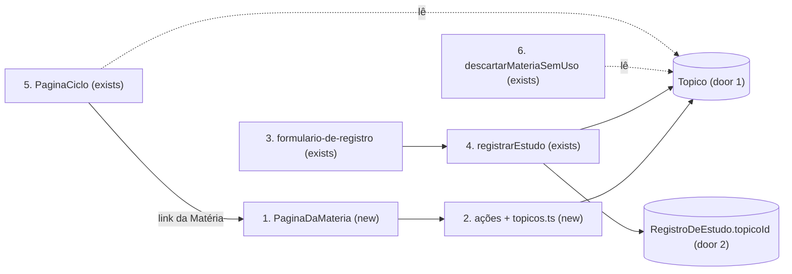
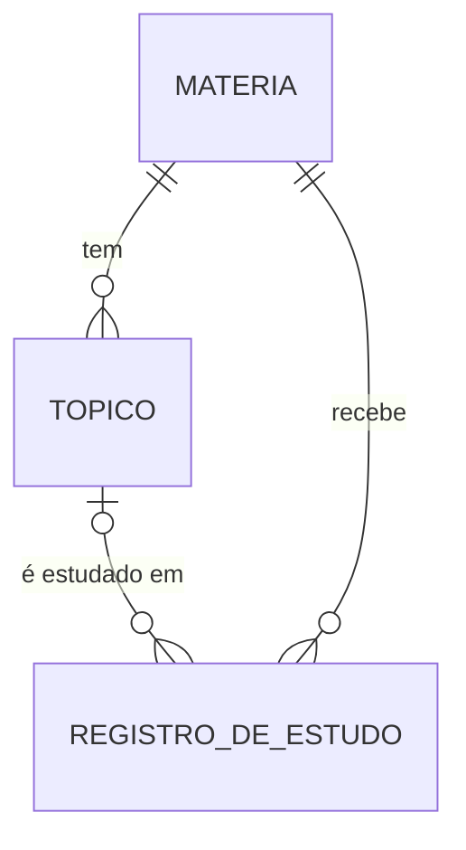
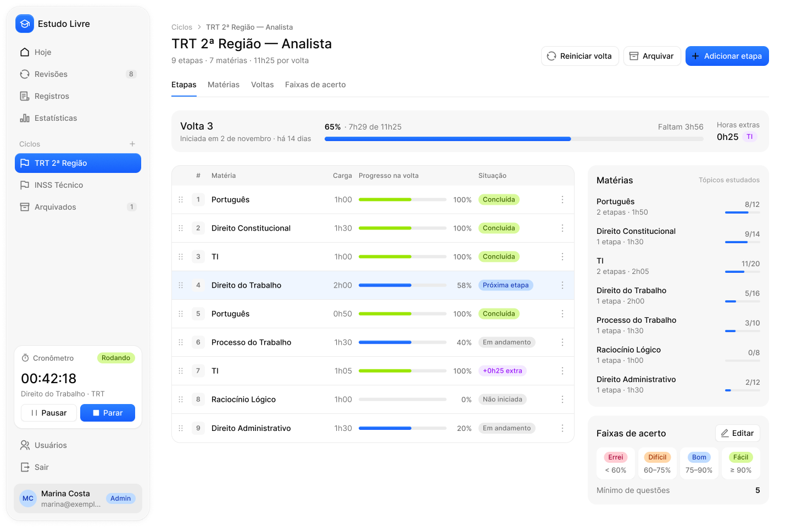
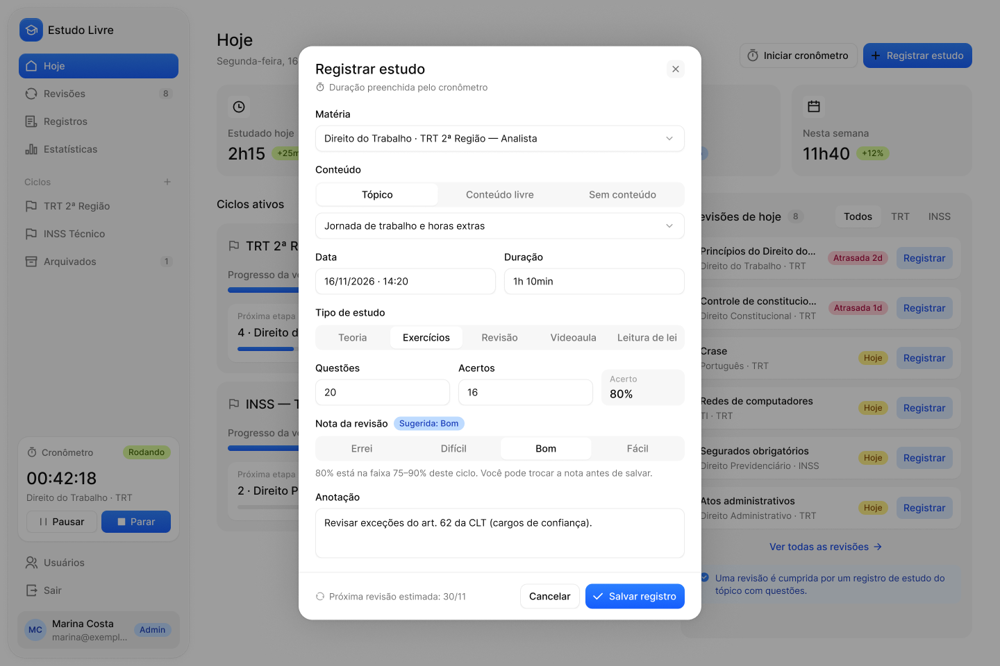

# Tópicos

**Approved**: 2026-11-17 - user: "aprovado podo implementar"

> Build this with **tlc-implement**. Every criterion becomes a check with a proof; nothing under
> the open questions is settled while building.

## Problem

Issue #7. Um registro de estudo só diz "estudei Direito do Trabalho"; o conteúdo programático da Matéria não existe no app. O Usuário que estuda para concurso precisa dizer **o que** estudou (um item do edital) e ver quanto do edital já cobriu, e hoje só tem o texto livre do registro (até 200 caracteres), que não soma, não se repete igual e não mostra progresso. Sem Tópicos também não há o que a issue #10 (Cartão de revisão) e a #12 (Revisões) precisam: um cartão por Tópico. Não há número medido: a instância tem um único Usuário.

Quando isto entrar, o Usuário cadastra ou cola a lista de Tópicos de uma Matéria, escolhe um Tópico ao registrar estudo, e vê "X de Y tópicos estudados" na Matéria e "X/Y" no cartão Matérias do Ciclo.

## Shape

Reusa o Registro de estudo (`registrarEstudo`), a Matéria e a trava do Ciclo que já existem, e os componentes do BoardUI já instalados (`SegmentedControl`, `Select`, `Textarea`, `Checkbox`, `Progress`, `Modal`). As regras que mudam o que o Usuário vê (duplicados, importação, contagem X de Y, marcar estudado, descartar Matéria) rodam em `src/casos-de-uso`, a camada que o Vitest alcança; as telas só formatam.

1. `/ciclos/[id]/materias/[materiaId]` -> `PaginaDaMateria` (new) - lê os Tópicos em ordem e o X de Y
2. gesto (criar, renomear, excluir, marcar, importar) -> server action (new) -> `topicos.ts` (new) - valida, grava `Topico` (door 1), devolve a lista
3. "Registrar estudo" -> `formulario-de-registro` (exists) - escolhe Matéria, o segmento mostra os Tópicos dela (os Tópicos vêm junto das Matérias que a Hoje e o Cronômetro já carregam)
4. `registrar` (exists) -> `registrarEstudo` (exists) - grava `RegistroDeEstudo` com `topicoId` (door 2) e, na mesma transação, marca o Tópico como estudado
5. `/ciclos/[id]` -> `PaginaCiclo` (exists) - passa a trazer `estudados` e `total` de Tópicos por Matéria
6. remover ou mover a última Etapa -> `descartarMateriaSemUso` (exists) - passa a manter a Matéria que tem Tópicos (AD-008)

**Changes underneath**

| Front | What changes |
| --- | --- |
| domain | "Conteúdo livre" e "Tópico" passam a ser exclusivos num Registro: um ou outro ou nenhum. Quem ramifica hoje: só `registrarEstudo` e o formulário (nada mais lê `conteudoLivre`) |
| stored data | tabela nova; coluna nova e nula em `registro_de_estudo`: nada a migrar, os Registros existentes ficam sem Tópico |
| readers | tela do Ciclo (coluna "Tópicos estudados", critérios 23-24); modal de registro (critérios 15-22); a Matéria sem Etapas mas com Tópicos não aparece no cartão do Ciclo (o cartão deriva das Etapas) e volta quando uma Etapa de mesmo nome é adicionada (critério 25); Estatísticas e Hoje não leem Tópico: nada muda |

New: `Topico` (Matéria 1:N Tópico) e a relação opcional Tópico 1:N Registro de estudo. One-way constraints: nome único por Matéria sem diferenciar maiúsculas (door 1); `topico_id` do Registro `on delete set null` (door 2).

## Surface

| Route | In | Out | Status | Who |
| --- | --- | --- | --- | --- |
| `GET /ciclos/[id]/materias/[materiaId]` | ids na rota | página da Matéria com os Tópicos | 200; 404 se a Matéria não é do Ciclo ou o Ciclo não é do Usuário; redirect ao login sem sessão | o dono do Ciclo |

## Landing

| One-way door | Literal shape | Alternative rejected |
| --- | --- | --- |
| 1. tabela `topico` | `topico(id text pk, materia_id fk→materia on delete cascade, nome text not null, estudado boolean not null default false, posicao integer not null)`; `unique (materia_id, lower(nome))`; índice `(materia_id, posicao)` | derivar "estudado" dos Registros: o Usuário não poderia marcar à mão nem desmarcar (AD-009). Nome só como texto no Registro: não soma nem se repete |
| 2. `registro_de_estudo.topico_id` | `topico_id text null references topico(id) on delete set null` | `on delete cascade`: apagaria horas e questões do histórico ao excluir o Tópico (AD-009) |

- Nada mais nesta mudança é difícil de reverter: a ordem é `posicao` simples e não há reordenação.

## Criteria

### S1: Manter os Tópicos de uma Matéria (P1)

O Usuário cria, renomeia, exclui, importa e marca Tópicos na página da Matéria e vê quanto já estudou.

**Acceptance Criteria**

1. WHEN o Usuário abre a Matéria no cartão Matérias do Ciclo (o nome da Matéria é um link) THEN o sistema SHALL abrir `/ciclos/<id>/materias/<materiaId>` com o nome da Matéria, o texto "X de Y tópicos estudados" e um `Progress` pequeno
   - 3 estudados de 10 → "3 de 10 tópicos estudados"; 1 de 1 → "1 de 1 tópico estudado"
2. IF a Matéria não tem Tópicos THEN a página SHALL mostrar "Nenhum tópico ainda" com os botões "Novo tópico" e "Importar tópicos", e SHALL NOT mostrar o `Progress`
3. WHEN o Usuário escreve um nome e usa "Novo tópico" THEN o sistema SHALL acrescentar o Tópico ao fim da lista, não estudado, e mostrá-lo
   - "  IA  " → grava "IA" (sem espaços nas pontas)
4. IF o nome, sem espaços nas pontas, é vazio ou tem mais de 120 caracteres THEN o sistema SHALL recusar com "O nome do tópico precisa ter de 1 a 120 caracteres." e não gravar
5. IF a Matéria já tem um Tópico de mesmo nome sem diferenciar maiúsculas THEN o sistema SHALL recusar com "Já existe um tópico com este nome nesta matéria."
   - "ia" já existe como "IA" → recusa; "IA" em outra Matéria do mesmo Ciclo → aceita
6. WHEN o Usuário usa "Renomear" num Tópico e confirma THEN o sistema SHALL trocar o nome mantendo posição, marca e Registros; IF o nome novo só muda maiúsculas do próprio Tópico ("ia" → "IA") THEN SHALL aceitar; IF colide com outro Tópico THEN SHALL recusar como no critério 5
7. WHEN o Usuário usa "Excluir" num Tópico THEN o sistema SHALL pedir confirmação com "Excluir o tópico “<nome>”?" e, se ele tem N ≥ 1 Registros, acrescentar "Os N registros de estudo dele continuam, sem conteúdo." (com N = 1: "O registro de estudo dele continua, sem conteúdo."); ao confirmar, SHALL remover o Tópico e manter todos os seus Registros com `topicoId` nulo
   - tópico com 2 Registros de 60 min → exclui; as horas da Matéria continuam 120 min; os 2 Registros existem sem Tópico
8. WHEN o Usuário cola texto em "Importar tópicos" e confirma THEN o sistema SHALL criar um Tópico por linha, na ordem das linhas, depois dos que já existem, ignorando linhas vazias (só espaços) e duplicadas (entre as linhas e contra os existentes, sem diferenciar maiúsculas) e SHALL mostrar "N importados, M ignorados."
   - "IA\n\n ia \nRedes\nredes\nSO" numa Matéria com "SO" → cria "IA" e "Redes"; "N importados, 3 ignorados."
9. IF o texto importado tem alguma linha com mais de 120 caracteres THEN o sistema SHALL recusar tudo com "A linha <n> passa de 120 caracteres." e não gravar nenhum; IF tem mais de 200 linhas não vazias distintas THEN SHALL recusar com "Importe no máximo 200 tópicos por vez."; IF o texto não tem nenhuma linha com conteúdo THEN SHALL mostrar "Nada para importar."
10. WHEN o Usuário marca ou desmarca o `Checkbox` de um Tópico THEN o sistema SHALL gravar a marca e atualizar o "X de Y" na mesma tela, valendo também com Registros existentes (AD-009)
    - Tópico com 1 Registro, desmarcado → "X-1 de Y"; um novo Registro dele o marca de novo
11. IF a Matéria, o Ciclo ou o Tópico não é do Usuário (ids de outro Usuário, ou Matéria de outro Ciclo) THEN toda leitura e ação desta página SHALL responder como "não encontrada" e não gravar nada
12. WHEN duas importações ou duas criações simultâneas trazem o mesmo nome THEN o sistema SHALL gravar um só Tópico e a outra chamada SHALL recusar ou ignorar como duplicado, sem erro 500
    - o que garante: o índice único de nome (door 1) e a trava da Matéria na gravação
13. WHEN o Usuário abre a página da Matéria em 375px, 768px e 1440px THEN a lista SHALL rolar na página, com "Renomear" e "Excluir" alcançáveis em cada linha e sem rolagem horizontal
14. WHEN o Usuário abre `/ciclos/<id>/materias/<materiaId>` THEN a página SHALL ter breadcrumb "Ciclos › <ciclo> › <matéria>" no padrão da tela do Ciclo, nos tokens BoardUI e com o vocabulário do `CONTEXT.md`

### S2: Registrar estudo com Tópico, Conteúdo livre ou nenhum (P1)

**Acceptance Criteria**

15. WHEN o Usuário abre "Registrar estudo" THEN o sistema SHALL mostrar o campo Conteúdo como no modal de `.specs/features/topicos/captures/registrar-estudo.png`: segmento "Tópico / Conteúdo livre / Sem conteúdo" e, em "Tópico", um `Select` com os Tópicos da Matéria escolhida, na ordem da Matéria
16. WHEN o Usuário troca a Matéria no modal THEN o `Select` SHALL passar a listar os Tópicos da nova Matéria e SHALL limpar o Tópico escolhido
17. IF a Matéria escolhida não tem Tópicos THEN o segmento SHALL abrir em "Conteúdo livre", com a opção "Tópico" desabilitada e a dica "Esta matéria ainda não tem tópicos."
18. WHEN o Usuário escolhe "Tópico" e um Tópico e salva THEN o sistema SHALL gravar o Registro com esse `topicoId`, sem Conteúdo livre
19. WHEN o Usuário escolhe "Conteúdo livre" e digita o texto THEN o sistema SHALL gravar o texto (até 200 caracteres, como hoje) sem Tópico; WHEN escolhe "Sem conteúdo" THEN SHALL gravar sem Tópico e sem texto; trocar de segmento descarta o que estava no outro
20. IF o segmento é "Tópico" e nenhum Tópico foi escolhido THEN o sistema SHALL recusar com "Escolha um tópico." sob o campo e não gravar
21. IF o pedido traz um Tópico de outra Matéria, de outro Usuário, ou traz Tópico e Conteúdo livre ao mesmo tempo THEN `registrarEstudo` SHALL recusar ("Escolha um tópico ou digite um conteúdo, não os dois." no caso dos dois; "Escolha um tópico desta matéria." nos outros) e não gravar
22. WHEN um Registro com Tópico é gravado THEN o sistema SHALL marcar esse Tópico como estudado na mesma transação do Registro; IF o Tópico já está marcado THEN SHALL deixá-lo marcado
    - 1º Registro do Tópico "IA" → estudado; Registro sem Tópico ou com Conteúdo livre → nenhum Tópico muda
    - registrar a partir do Cronômetro segue o mesmo caminho

### S3: "Tópicos estudados" no cartão do Ciclo (P2)

**Acceptance Criteria**

23. WHEN o Usuário abre `/ciclos/<id>` em 1440px THEN o cartão Matérias SHALL ter a coluna "Tópicos estudados" como em `.specs/features/topicos/captures/ciclo.png` (texto "X/Y" à direita e `Progress` pequeno por Matéria); as abas, "Reiniciar volta", "Arquivar" e "Faixas de acerto" desse frame continuam fora (AD-001)
24. IF uma Matéria do cartão não tem Tópicos THEN a coluna SHALL mostrar "—" e nenhum `Progress`; o "X/Y" conta todos os Tópicos da Matéria, estudados ou não, e muda assim que o Usuário marca, desmarca, importa, exclui ou registra
25. WHEN o Usuário remove a última Etapa de uma Matéria que tem Tópicos THEN a Matéria SHALL continuar com os Tópicos, fora do cartão; WHEN uma Etapa de mesmo nome é adicionada ao Ciclo depois THEN a mesma Matéria, com os mesmos Tópicos, SHALL voltar ao cartão (AD-008)
    - Matéria sem Tópicos e sem Registros, última Etapa removida → apagada como hoje

## Out of scope

| Excluded | Why |
| --- | --- |
| Subtópicos | `CONTEXT.md`: Tópico não tem subtópicos |
| Reordenar Tópicos à mão | a issue não pede; a ordem é a de criação/importação |
| Cartão de revisão por Tópico e "Revisões de hoje" | issues #10 e #12 |
| Copiar Tópicos ao copiar Matéria de outro Ciclo | issue #8 |
| Editar ou excluir Registros e o histórico | issue #5 |
| Importar de arquivo (CSV, PDF) | a issue só cola texto |
| Excluir ou renomear a Matéria a partir da página | não é pedido; Matéria só some pela regra de AD-008 |

## Assumptions

| Assumption | Chosen default | Rationale | Confirmed? |
| --- | --- | --- | --- |
| Onde a gestão vive | página `/ciclos/[id]/materias/[materiaId]` | nenhum frame desenha; pergunta "Onde essa gestão vive?" - "Página da Matéria (Recomendado)" | y |
| Excluir Tópico com Registros | Registros ficam, sem conteúdo (AD-009) | pergunta respondida | y |
| Matéria com Tópicos sem Etapas | mantida (AD-008) | pergunta respondida | y |
| Desmarcar com Registros | vale a marca manual (AD-009) | pergunta respondida | y |
| Duplicado | sem diferenciar maiúsculas, após aparar as pontas; acentos contam | igual ao índice de Matéria por Ciclo | n |
| Limites | nome 1 a 120 caracteres; 200 linhas por importação | caber no `Select` do modal; um edital grande cabe em 1 colagem | n |
| Importar com linha longa | recusa tudo | evita importação pela metade | n |
| Matéria sem Tópicos no cartão | "—", sem `Progress` | X/0 não tem leitura | n |
| Segmento inicial | "Tópico" quando a Matéria tem Tópicos, sem Tópico escolhido (obriga a escolher); "Conteúdo livre" quando não tem | o frame abre em "Tópico" | n |

**Open questions:** none - all resolved or logged above.

## Differences from the source

| Source shows | Product shows | Confirmed |
| --- | --- | --- |
| Abas, "Reiniciar volta", "Arquivar", "Faixas de acerto" no frame do Ciclo | nada; só a coluna "Tópicos estudados" entra | y - AD-001 |
| "Nota da revisão", "Próxima revisão estimada" e Revisões no modal | nada (issues #10 e #12) | y - AD-001 |
| Data "dd/mm/aaaa · hh:mm" | só a data | y - AD-007 |

## Sources

- Issue #7 "Tópicos" (GitHub) - binding - critérios de aceite e a seção Interface
-  - binding - exportado do Figma `ig7Pq2uPxPWjeWuCKmTuBW`, 2026-11-17 - coluna "Tópicos estudados"
-  - binding - exportado do Figma `ig7Pq2uPxPWjeWuCKmTuBW`, 2026-11-17 - segmento "Tópico / Conteúdo livre / Sem conteúdo"
- `docs/design-system.md` e `.specs/STATE.md` (AD-001, AD-007) - binding - estilo e escopo visual
